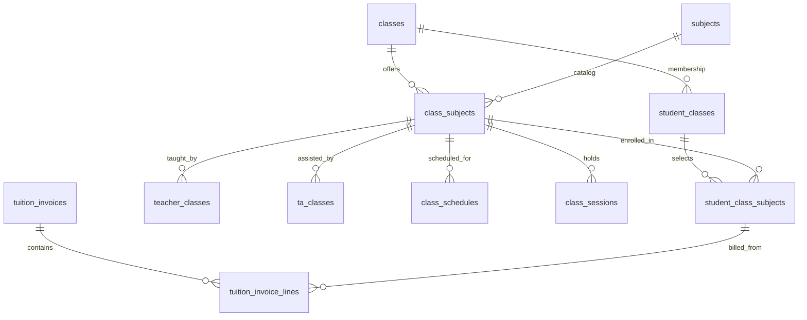

# EduTrack — Task 01: Core Class Management

## Căn cứ và phạm vi

- Checkout local và nhánh `Duy` trên GitHub trùng commit gốc `1990329683030822fbe1315cdb688a6bd068b234` khi bắt đầu.
- Đã đối chiếu báo cáo Capstone I trong `docs/`: CM-02, CM-06, AD-03, AD-04, AD-11, bảng Classes và Tuition Invoices.
  Bảng Classes mô tả `tuition_fee` là **monthly tuition rate in VND**. Vì vậy nhãn được sửa thành **Học phí/tháng**,
  giữ nguyên số tiền đang lưu; không quy đổi dữ liệu cũ và không sinh hóa đơn.
- Đã đối chiếu `EduTrack_Final_Conflict_Resolution.md`, `API_Contract.md`, `Backend_CQRS_BoundedContext_Guide.md`,
  DTO, controller, service, repository, entity và migration hiện tại.
- Hai file `EDUTRACK_CODEX_HANDOFF.md`, `CODEX_START_HERE.md` không có trong checkout, không tìm thấy qua tên file
  hoặc lịch sử Git local. Không giả định đã đọc được nội dung của hai file này; dùng tài liệu hiện có và yêu cầu Task 01 làm căn cứ.
- Không đổi database schema, migration, Authentication/Authorization, Sidebar/TopBar, module thu tiền hoặc chính sách học phí.
  Không commit, push hay merge. Commit sau này cần gửi message để người dùng xem và xác nhận trước.

## A. Đã triển khai

### Class List và form dùng chung

Hai route cũ `/center-manager/classes`, `/admin-staff/classes` được giữ nguyên.
Hai page cũ trở thành wrapper của `ClassManagementPage`, tránh duy trì hai bộ CRUD gần 900 dòng trùng nhau.
Giữ bảng, bộ lọc, modal, button, badge, pagination và phong cách Bootstrap đang có; không thêm CSS toàn cục.

- Danh sách lấy từ GET `/api/classes`; tìm theo tên lớp, lọc ID môn và trạng thái, sắp xếp A-Z/Z-A/ID mới-cũ, phân trang.
- Có loading, lỗi GET kèm nút thử lại, rỗng thật và không có kết quả lọc riêng biệt.
- Lớp và danh mục môn tải độc lập. Khi Subjects lỗi, lớp vẫn hiển thị và bộ lọc có thể dùng thông tin môn thật từ ClassDto.
- Sau Delete, số trang được chặn theo tổng mới, không kẹt ở trang rỗng. Không hiển thị “Showing 1 to 0”.
- Create/Edit dùng chung `ClassFormModal`, chia nhóm A thông tin lớp; B môn và học phí; C phòng/lịch.
- Create chỉ có `active` và `upcoming`, được kiểm tra ở cả form và Backend. Edit/filter vẫn giữ các trạng thái lớp cũ.
- Đã bỏ ba đoạn chú thích nhỏ trong form theo yêu cầu; giữ thông báo lỗi và validation cần thiết.
- Không mặc định `subjectId=1`, môn đầu tiên, phòng 201 hoặc phí 3 triệu. Người dùng phải chọn môn thật và nhập phí.
- Số 0 là học phí hợp lệ khi người dùng nhập 0; ô phí trống không được đổi ngầm thành 0.
- Validate tên, môn có trong danh mục, phòng tối đa 50 ký tự, phí không âm/đúng decimal(12,2), ngày có thật,
  ngày kết thúc không trước khai giảng, trạng thái bắt buộc. Backend xác nhận SubjectId thực sự tồn tại.
- Backend Create không tự gán ngày hiện tại khi client thiếu ngày khai giảng nữa; request thiếu ngày bị từ chối.
- Edit phải GET lại đúng classId. Lỗi GET không mở dữ liệu cũ lấy từ hàng trong bảng để thay thế.
- Lỗi POST/PUT hiển thị trong modal và giữ nguyên draft. Khi đang lưu, khóa nút/field để tránh gửi trùng.
- Chỉ báo thành công sau response Backend hợp lệ. Sau thao tác thành công đọc lại danh sách, không phát sinh ID giả.
- Update chỉ gửi/cập nhật scalar ClassDto hiện có, không thay collection học sinh, Teacher/TA hay lịch.
- Thông báo validation ASP.NET và lỗi nghiệp vụ Backend được giữ qua tầng API, không biến thành fake success.

### Class Details

Thêm hai route con, giữ layout cha và không bổ sung quy tắc quyền:

- `/center-manager/classes/:id`
- `/admin-staff/classes/:id`

Trang dùng chung có bốn tab:

| Tab | Dữ liệu hiển thị | Nguồn thật |
| --- | --- | --- |
| Overview | Tên, trạng thái, ngày bắt đầu/kết thúc, phòng, học phí/tháng hiện tại | GET `/api/classes/{id}` |
| Subjects | Môn hiện tại, mã môn, phí lớp; danh sách Teacher và TA được phân công theo lớp | ClassDto; GET `/api/teacherclasses`, `/api/taclasses`, lọc đúng classId |
| Students | Học sinh, mã, ngày đăng ký và trạng thái tham gia lớp | GET `/api/studentclasses`, lọc đúng classId |
| Schedule | Lịch tuần và các buổi đã tạo; thời gian, phòng, trạng thái thật | GET `/api/classschedules`, `/api/classsessions`, lọc đúng classId |

Các nhóm tải độc lập, có loading/error/empty riêng. Lỗi Teacher không che TA hoặc Students.
Không suy diễn buổi học từ lịch tuần. Mã lớp không hợp lệ hoặc không tìm thấy có error state, không dùng lớp khác thay thế.

**Giới hạn hiển thị được nói rõ trong UI:** một Class hiện chỉ lưu được một Subject.
Students chỉ có membership theo lớp, chưa có lựa chọn từng môn; cột môn đăng ký ghi chưa có dữ liệu theo môn.
Không tự cho rằng học sinh học toàn bộ môn. Teacher/TA được phân công theo lớp qua hai API mới
`POST /api/classes/{classId}/teachers` và `/assistants`; chưa có phân công theo Class Subject.
Không tạo nút lưu nhiều môn hoặc giả lập phân công thành công.
Không có trường khối lớp vì Class entity/DTO hiện không cung cấp khối lớp độc lập; không đoán khối từ tên lớp.

### Delete: hành vi thực tế

Repository hiện chặn Delete khi có **bất kỳ** dòng `student_classes` (không chỉ học sinh active).
Khi được xóa, repository xóa các dòng Teacher/TA và lịch tuần; các FK trong migration còn có cascade tới
buổi học, nội dung học, nhận xét, hóa đơn và các bảng phụ thuộc khác. Khẳng định cũ “có lịch học thì không xóa được” không đúng với code này.

Modal đã sửa cảnh báo đúng về xóa vĩnh viễn và dữ liệu phụ thuộc; gợi ý Inactive để giữ lịch sử.
Nếu DELETE bị Backend từ chối, modal giữ nguyên lớp và thông báo lỗi để người dùng hủy/thử lại, không tự làm mất target.
Task này **không thay đổi chính sách hard delete**, không chỉnh FK/cascade. Cấu hình MySQL thật vẫn cần đối chiếu metadata.

### Kết quả kiểm thử

| Kiểm tra | Kết quả và giới hạn |
| --- | --- |
| Frontend `npm.cmd run build` | Thành công; còn cảnh báo bundle >500 kB đã có |
| Backend build ra thư mục tạm với `UseAppHost=false` | Thành công; ba cảnh báo CS8601 đã có ở TeachingRequestService/LearnerDashboardService |
| Class unit/API tests | 15 bài đạt: dữ liệu mặc định, chọn môn, phí, ngày, trạng thái Create/Edit, payload, filter/sort, API lỗi, response sai ID/malformed, relation theo classId |
| Toàn bộ các test liên quan, gồm hồi quy học phí | 58 bài Node test đạt |
| Browser Class Management | 30 nhóm kịch bản đạt cho 2 vai trò × desktop 1440×1000, tablet 768×1024, mobile 390×844 |
| CRUD trong browser | 36 request POST/PUT/DELETE được interceptor xử lý bằng fixture; không gọi Backend/MySQL thật |
| Backend DTO/policy/service | 28 kiểm tra với repository trong bộ nhớ: dữ liệu đầu vào, SubjectId không tồn tại, trạng thái khi tạo lớp, update giữ collection/trạng thái lớp cũ, lỗi Delete; project ở thư mục tạm, không thêm vào Git |
| Hồi quy KPI đã chốt | 300 tình huống browser trên sáu trang, giữ số liệu/layout đã chốt |

Browser kiểm tra Create bắt buộc/âm phí/sai ngày, POST lỗi giữ form, lưu đúng payload với một môn đã chọn;
Edit đọc dữ liệu mới thay dữ liệu danh sách, GET/PUT lỗi; Delete bị từ chối và thử lại; xóa trang cuối;
search/filter/sort/pagination; lỗi riêng Subjects, loading, empty; Details bốn tab, lọc đúng classId,
Teacher API lỗi nhưng TA/Students vẫn tải; route ID sai; modal có thể cuộn và nút lưu không vượt màn hình mobile.

**Chưa xác minh:** dữ liệu sống và CRUD trên MySQL thật, FK thực tế có khớp migration không, quyền của từng tài khoản,
hiệu năng danh sách toàn trung tâm, xóa dây chuyền thật. Không xem API fixture hoặc fake repository là bằng chứng đã ghi thành công MySQL.

### Chạy lại và kiểm thử với Backend/MySQL

Từ `Capstone2/frontend`:

```powershell
npm.cmd run build
node --test tests/classManagement.test.mjs tests/classManagementApi.test.mjs
node tests/classManagement.browser.mjs
```

Browser dùng `dist`, mở server loopback ngẫu nhiên, chặn các API bằng fixture và ghi ảnh/JSON vào thư mục tạm
`edutrack-class-management-*`. Có thể đặt `$env:CHROME_PATH` nếu Chrome không ở đường dẫn mặc định Windows.

Từ gốc repo, build Backend mà không đụng exe Backend đang chạy:

```powershell
$classBuildOutput = Join-Path $env:TEMP 'EduTrack-ClassManagement-Build'
dotnet build Capstone2/backend/EduTrack.API.csproj --no-restore -p:UseAppHost=false --output $classBuildOutput
```

Bộ 28 kiểm tra Backend local hiện nằm trong `$env:TEMP/EduTrack-ClassManagement-Checks/`:

```powershell
dotnet run --project "$env:TEMP/EduTrack-ClassManagement-Checks/ClassChecks.csproj"
```

Thư mục này là artifact kiểm thử trên máy hiện tại, không thuộc repo và có thể bị hệ điều hành dọn dẹp.
`backend.Tests` cũ vẫn được ignore như đã thống nhất; không đưa test Backend sang vị trí khác để lách giới hạn commit.

Với **database kiểm thử** của bạn:

1. Chạy Backend hiện có, mặc định HTTP cổng 5036, và frontend `npm.cmd run dev`. Không cần migration.
2. Mở cả hai route Classes, kiểm tra GET `/api/classes` và `/api/subjects` có 200. Chọn môn từ dữ liệu thật.
3. Tạo lớp test với tên mới, phí 0 hoặc số tiền bạn nhập, phòng để trống và ngày hợp lệ. Kiểm tra Network:
   payload không có subjectIds giả, Teacher/TA/Students/Schedules bị ghi đè hoặc ID tự chế; response 201 có ID Backend.
4. Tải lại trình duyệt và kiểm tra lớp vẫn tồn tại. Dùng SQL SELECT kiểm tra `classes` theo ID trả về.
5. Edit lớp đã có liên kết, sửa scalar hợp lệ, so sánh các bản ghi liên kết trước/sau. Đổi môn vẫn là **thay môn của lớp hiện tại**,
   không phải thêm môn; việc giữ lịch sử môn cũ cần mô hình ở phần B, chưa được giải quyết bằng schema hiện tại.
6. Kiểm tra Details và các tab đối chiếu các query GET đã liệt kê. Students không được hiện môn tự suy diễn.
7. Chặn GET `/api/classes`, `/api/subjects`, `/api/classes/{id}`, hoặc một relation API bằng DevTools:
   kiểm tra lỗi riêng, nút thử lại và không hiện chi tiết từ hàng cũ. Dùng database/API test để kiểm tra POST/PUT/DELETE 400.
8. Chỉ Delete lớp test không có lịch sử cần giữ. Lớp có dòng student_classes phải nhận lỗi; không Delete lớp có hóa đơn thật để thử cascade.
9. Kiểm tra mobile/tablet: bảng cuộn ngang bên trong, form cuộn dọc và các nút Hủy/Lưu vẫn truy cập được.

Đối chiếu **chỉ đọc** metadata và dữ liệu:

```sql
SHOW CREATE TABLE classes;
SHOW CREATE TABLE student_classes;
SHOW CREATE TABLE class_sessions;
SHOW CREATE TABLE tuition_invoices;

-- Điền ID thật từ response tạo/sửa lớp trong phiên kiểm thử.
SET @class_id = NULL;
SELECT class_id, class_name, subject_id, room, tuition_fee, start_date, end_date, status
FROM classes WHERE class_id = @class_id;
SELECT * FROM student_classes WHERE class_id = @class_id;
SELECT * FROM teacher_classes WHERE class_id = @class_id;
SELECT * FROM ta_classes WHERE class_id = @class_id;
SELECT * FROM class_schedules WHERE class_id = @class_id;
SELECT * FROM class_sessions WHERE class_id = @class_id;
SELECT * FROM tuition_invoices WHERE class_id = @class_id;
```

## B. Cần phê duyệt — mô hình Class–Subject

Đây là **đề xuất**, chưa có entity, migration, DDL thực thi hoặc API mới tương ứng trong source.
Mô hình cũ trong Capstone I có một môn/lớp; yêu cầu Task 01 chốt hướng nhiều môn nên cần thiết kế mở rộng có phối hợp cả nhóm.

### Cấu trúc đề xuất



| Bảng | Cấu trúc/khóa đề xuất |
| --- | --- |
| `classes` | Giữ ID/tên/ngày/trạng thái/phòng mặc định. `subject_id` và `tuition_fee` chuyển thành trường legacy trong giai đoạn mở rộng, chỉ bỏ sau khi mọi client đã chuyển đổi. Khối lớp cần metadata riêng nếu được duyệt, không parse từ tên. |
| `class_subjects` (mới) | `class_subject_id` PK; `class_id` FK classes; `subject_id` FK subjects; `tuition_fee` DECIMAL(12,2) không âm theo tháng; `status`; UNIQUE(class_id, subject_id). FK không tự cascade lịch sử tài chính. |
| `student_classes` | Giữ membership của học sinh với lớp và ID sc_id hiện tại, không đồng nghĩa học tất cả môn. |
| `student_class_subjects` (mới) | PK riêng; `sc_id`, `class_subject_id`, `class_id`, ngày đăng ký, trạng thái/ngày nghỉ. UNIQUE(sc_id, class_subject_id). Thêm unique phụ `(sc_id, class_id)` ở membership và `(class_subject_id, class_id)` ở class_subjects để dùng hai composite FK cùng `class_id`, ngăn đăng ký môn của lớp khác. |
| `teacher_classes`, `ta_classes` | Thêm `class_subject_id` nullable trong giai đoạn chuyển đổi; sau backfill bắt buộc cho phân công theo môn. Đổi unique hiện tại `(teacher_id, class_id)`/`(ta_id, class_id)` thành `(teacher_id, class_subject_id)`/`(ta_id, class_subject_id)` khi nâng cấp xong. Giữ classId nhất quán với class_subjects bằng composite FK. |
| `class_schedules` | Thêm class_subject_id; lịch có ngày/giờ/phòng gắn môn. ClassId giữ tương thích và phải khớp cùng lớp. Kiểm tra trùng giáo viên/phòng và lịch học sinh khi triển khai Schedule sau này. |
| `class_sessions` | Thêm class_subject_id; buổi có scheduleId phải cùng Class Subject với lịch nguồn, buổi ngoài lịch vẫn phải chỉ rõ môn. Điểm danh tiếp tục theo session, danh sách tham gia lấy từ student_class_subjects. |
| `tuition_invoices` | Giữ header studentId/classId/periodMonth/year/amountDue/dueDate/status để Payment và Approval tiếp tục gắn invoiceId. Không đổi deadline một tháng đã chốt. |
| `tuition_invoice_lines` (mới) | PK line; invoiceId FK; student_class_subject_id FK; số tiền/đơn giá theo tháng được snapshot tại lúc lập hóa đơn. Tổng header phải khớp các dòng và điều chỉnh đã được phê duyệt. Không cộng phí của môn học sinh không đăng ký. |

Các unique/composite FK, quy tắc delete và ràng buộc tiền phải được kiểm tra trên phiên bản MySQL thực tế trước khi viết migration.
Nếu cho phép học lại cùng môn nhiều đợt, cần chốt cách lưu lịch sử đợt đăng ký thay vì cập nhật mất ngày đăng ký cũ.
Nếu chỉ cho một giáo viên chính/môn hoặc cho nhiều giáo viên, cần chốt rule riêng; hiện schema cũ cho nhiều phân công theo lớp.

### DTO/API đề xuất

| API/DTO mới | Hành vi cần có |
| --- | --- |
| Create/Update Class V2 | Thông tin lớp riêng và danh sách `subjects[]` chứa SubjectId, phí/tháng; transaction lưu đủ các môn hoặc rollback toàn bộ. Cấm lặp SubjectId. Không tự gán môn đầu tiên. |
| GET Class Details V2 | Trả `subjects[]` với classSubjectId, SubjectId/tên/mã, giá theo tháng, phân công; membership và môn đăng ký được tách bạch. |
| POST/PUT `/api/class-subjects/{id}/teachers`, `/assistants` | Validate vai trò và tình trạng tài khoản theo phần Authorization của thành viên phụ trách; không ghi phân công vào cả lớp một cách ngầm định. |
| Enrollment V2 | Nhận `studentId`, `classId`, `classSubjectIds[]` được chọn rõ. Validate tất cả môn thuộc đúng lớp, hoạt động và không trùng; lưu membership + đăng ký môn trong một transaction. Không tự enroll tất cả môn. |
| Schedule/Session V2 | Request/response có classSubjectId, trả môn tương ứng và kiểm tra ràng buộc lịch. |
| Invoice generation V2 | Lập dòng tiền từ đăng ký môn hợp lệ của học sinh trong kỳ và snapshot mức phí; không dùng toàn bộ danh sách môn của lớp để thu của mọi học sinh. |

Chưa chốt route version cụ thể; có thể dùng `/api/v2/...` hoặc endpoint mới sau khi thống nhất với các thành viên.
Không thể vừa giữ DTO chỉ có một SubjectId vừa tuyên bố dữ liệu nhiều môn đã được hỗ trợ đầy đủ cho client cũ.
Chỉ bật tạo lớp nhiều môn khi các màn hình/luồng bị ảnh hưởng đã chuyển sang DTO mới; legacy write không được lặng lẽ bỏ bớt các môn.

### Chuyển dữ liệu cũ

1. Sao lưu, đối chiếu metadata và kiểm kê dữ liệu mồ côi/trùng, mức phí bất thường và ngày trước khi tạo migration được duyệt.
2. Thêm cấu trúc mới theo hướng expand, giữ ID Class/Subject/StudentClass/TeacherClass/TA/Invoice hiện tại.
3. Với mỗi Class cũ, tạo **đúng một** ClassSubject từ `classes.subject_id` và giá cũ; không tạo những môn khác theo tên/khối.
4. Với từng student_classes cũ, ánh xạ vào ClassSubject duy nhất của Class cũ theo trạng thái và ngày đang lưu.
   Đây là chuyển đổi quan hệ một môn đã tồn tại, không phải giả định học sinh học mọi môn của lớp trong tương lai.
5. Backfill Teacher/TA, lịch tuần, buổi học về đúng ClassSubject cũ. Báo lỗi đối chiếu khi thiếu class/subject, không dùng ID mặc định.
6. Hóa đơn cũ được giữ nguyên amountDue/Payments/dueDate/status; tạo một dòng legacy về ClassSubject cũ để bảo toàn lịch sử.
   Không tính lại tiền cũ từ giá hiện tại, không chia ngẫu nhiên tiền của hóa đơn cho nhiều môn.
7. Nâng cấp đồng bộ query, command và các client, kiểm tra số lượng bản ghi/tổng tiền/trạng thái và đối chiếu học sinh mẫu.
8. Chỉ bật lớp nhiều môn sau kiểm thử; khi thêm môn mới, học sinh hiện có **không tự được đăng ký**.
   Cuối cùng mới cân nhắc bỏ trường/unique legacy trong một đợt migration riêng.

### Module bị ảnh hưởng và rủi ro

- Class/Subject CRUD, Student Enrollment/Transfer và danh sách lớp của Student/Parent: thay từ membership lớp sang môn đã chọn.
- Teacher/TA assignments, lịch cá nhân, Schedule/Session và Attendance: buổi học phải trỏ môn và danh sách tham gia đúng.
- Content Units, Assignments, Submission, Progress Notes và AI grading: nội dung/bài tập theo môn; không cho lẫn nội dung các môn trong một lớp.
- Tuition/Payment/Approval/Reports/KPI: bảo toàn invoiceId, Payments và tổng tiền cũ; thêm invoice lines, không đổi nguyên tắc tổng hợp tiền thật.
- Notifications, export và Authorization do các thành viên khác phụ trách: thông báo và phạm vi truy cập theo đăng ký/phân công môn, cần phối hợp, chưa sửa trong task này.
- Legacy client bỏ sót môn nếu tiếp tục hiểu ClassDto một môn; không mở nhiều môn trước khi nâng cấp các luồng phụ thuộc.
- Đổi subjectId của lớp hiện có có thể làm mất ý nghĩa môn lịch sử dù FK học sinh/lịch không bị xóa; cần quy tắc ngừng môn/thêm môn thay cho ghi đè.
- Query relation hiện lấy toàn bộ danh sách rồi lọc client; cần endpoint chi tiết/phân trang theo classId khi dữ liệu lớn, kèm kiểm soát quyền phía server bởi người phụ trách.
- Giá cũ từng được UI ghi nhãn “trọn khóa” cần kiểm kê ý nghĩa thật trước khi backfill phí/tháng. Task này chỉ sửa nhãn theo tài liệu, không tự đổi số tiền.
- Hard delete/cascade có thể xóa lịch sử học tập/tài chính: đề xuất ưu tiên Inactive và chặn hard delete khi có buổi học/hóa đơn/lịch sử.
  Đây là thay đổi chính sách cần được duyệt; chưa thêm guard hoặc migration trong task này.

### Những quyết định cần chốt trước giai đoạn tiếp theo

1. Duyệt cấu trúc ClassSubject + đăng ký môn + invoice lines và kế hoạch chuyển đổi toàn bộ client.
2. Phí theo tháng: áp dụng đơn giá snapshot nào, học giữa tháng có tính đủ hay chia theo buổi, thời điểm đổi giá; chưa tự triển khai quy tắc mới.
3. Teacher/TA theo môn: một/nhiều người, ngày hiệu lực và cách giữ lịch sử phân công.
4. Vòng đời đăng ký môn: học lại, nghỉ/bảo lưu, chuyển lớp, điều kiện sinh hóa đơn; không phát sinh Enrollment đầy đủ trong Task 01.
5. Quy tắc đổi/xóa môn trong lớp đã có dữ liệu và chính sách bảo toàn lịch sử khi Delete Class.
6. Cần khối lớp/danh mục grade riêng hay chưa; DTO hiện tại chưa có dữ liệu cho trường này.

## File thay đổi

| File | Nội dung |
| --- | --- |
| `Capstone2/frontend/src/GUIs/pages/admin/CenterManager/CenterManagerClassPage.tsx` | Wrapper giữ route Center Manager |
| `Capstone2/frontend/src/GUIs/pages/admin/AdminStaff/AdminStaffClassPage.tsx` | Wrapper giữ route Admin Staff |
| `Capstone2/frontend/src/GUIs/pages/admin/shared/ClassManagementPage.tsx` | Danh sách, filter/sort/pagination, CRUD, loading/error/empty và Delete đúng hành vi |
| `Capstone2/frontend/src/GUIs/pages/admin/shared/ClassDetailsPage.tsx` | Overview/Subjects/Students/Schedule từ dữ liệu thật |
| `Capstone2/frontend/src/GUIs/components/management/classes/ClassFormModal.tsx` | Form chung, nhóm A/B/C, validation, giữ draft và GET mới khi Edit |
| `Capstone2/frontend/src/GUIs/hooks/useClassManagement.ts` | Tải độc lập, bỏ kết quả request cũ và chặn dùng chi tiết lớp cũ |
| `Capstone2/frontend/src/BLL/models/ClassManagement.ts` | Kiểu form và DTO relation bám Backend hiện có |
| `Capstone2/frontend/src/BLL/services/classManagementService.ts` | Validation, payload scalar, lọc/sắp xếp, ngày date-only |
| `Capstone2/frontend/src/api/classApi.ts` | GET lỗi rõ ràng, kiểm tra danh sách/identity response |
| `Capstone2/frontend/src/api/classManagementApi.ts` | Query relation hiện có và lọc classId thật |
| `Capstone2/frontend/src/api/apiError.ts` | Đọc lỗi nghiệp vụ/validation ASP.NET |
| `Capstone2/frontend/src/api/managementApi.ts` | Chỉ phần Class CRUD: error parsing, response xác nhận đúng lớp |
| `Capstone2/frontend/src/routes/centerManager.routes.tsx` | Route con Class Details trong layout cũ |
| `Capstone2/frontend/src/routes/adminStaff.routes.tsx` | Route con Class Details trong layout cũ |
| `Capstone2/backend/Models/DTOs/Management/CreateClassDto.cs` | Validation liên trường, không tự tạo ngày mặc định khi request thiếu ngày |
| `Capstone2/backend/Models/DTOs/Management/UpdateClassDto.cs` | Validation liên trường |
| `Capstone2/backend/Services/Management/ClassValidation.cs` | Policy kiểm tra dữ liệu đầu vào, không thay schema |
| `Capstone2/backend/Services/Management/Implementation/ManagementClassService.cs` | Validate và xác nhận môn tồn tại trước lưu scalar |
| `Capstone2/frontend/tests/classManagement.test.mjs` | Test business validation, payload và filter/sort |
| `Capstone2/frontend/tests/classManagementApi.test.mjs` | Test lỗi/response/identity và relation query |
| `Capstone2/frontend/tests/classManagement.browser.mjs` | Browser test hai vai trò, ba viewport, CRUD và Details bằng API fixture |
| `docs/EDUTRACK_CLASS_MANAGEMENT_TASK01.md` | Báo cáo, kiểm thử, hướng dẫn và đề xuất chờ duyệt |

## Bổ sung 07/11/2026: phân công Teacher/TA theo lớp

Theo quyết định mới của người dùng: Center Manager/Admin Staff tạo lớp và phân công người dạy;
lịch học, buổi học và tài liệu do giáo viên phụ trách. Tab Schedule hiện tại chỉ đọc dữ liệu đã có,
không thêm thao tác xếp lịch hay tạo tài liệu trong luồng phân công.

Tại **Classes → Class Details → Subjects**, có nút **Phân công giáo viên** và **Phân công trợ giảng**.
Dropdown lấy tài khoản thật qua GET `/api/users`, chỉ chọn đúng vai trò `teacher`/`teaching_assistant`
và trạng thái `active`; loại người đang có phân công active trong chính lớp đang mở.
Không đoán chuyên môn bằng tên môn hay ép một giáo viên chính vì schema hiện hỗ trợ nhiều người/lớp.
Trợ giảng là tùy chọn; không bắt buộc có phân công để lưu lớp mới.

Hai POST nhận `{userId}`, xác thực lại lớp, tài khoản, vai trò và trạng thái tại Backend;
ghi vào `teacher_classes`/`ta_classes` hiện có. Phân công active bị trùng trả 409;
nếu đã có liên kết inactive thì kích hoạt lại chính liên kết đó, không tạo dòng mới.
Unique index sẵn có bảo vệ hai request thêm mới đồng thời; không đổi entity, schema hay migration.
Không có thao tác xóa/thay thế hàng loạt hoặc tự ghi đè giáo viên khác trong task này.

Mỗi phân công active có nút **Ngừng phân công** và hộp xác nhận rõ người/lớp. Hai API:

- `PATCH /api/classes/{classId}/teachers/{assignmentId}/deactivate`
- `PATCH /api/classes/{classId}/assistants/{assignmentId}/deactivate`

Chỉ cập nhật cột `status` thành `inactive` với điều kiện khớp cả classId và assignmentId;
giữ ID, thời điểm phân công cũ và các bản ghi lớp/người/lịch/tài liệu/bài tập.
Không yêu cầu tài khoản còn active hoặc còn đúng vai trò để ngừng một phân công cũ.
Sai lớp hoặc không có phân công trả 404; gọi lại với bản ghi đã inactive vẫn xác nhận trạng thái hiện tại.
Sau khi ngừng, có thể chọn lại người đó nếu tài khoản vẫn đủ điều kiện; POST tái kích hoạt cùng ID.

Chỉ báo thành công khi response có ID phân công hợp lệ, đúng lớp/người/vai trò và trạng thái active;
sau đó tải lại chi tiết từ API. Lỗi giữ modal và lựa chọn hiện tại; khóa lưu khi đang gửi.
Assignment active là dữ liệu mà Teaching My Classes đang truy vấn, không sửa module Teaching hoặc phân quyền.

### File bổ sung cho phân công

| Nhóm | File và thay đổi |
| --- | --- |
| Backend API | `Controllers/Management/ManagementClassStaffController.cs`, `Models/DTOs/Management/AssignClassStaffDto.cs`: hai POST phân công, hai PATCH ngừng phân công; trả 400/404/409 đúng tình huống |
| Backend service | `Services/Management/Interfaces/IManagementClassStaffService.cs`, `Services/Management/Implementation/ManagementClassStaffService.cs`; đăng ký trong `Helpers/DependencyInjection/ManagementServiceExtensions.cs` |
| Backend repository | `ITeacherClassRepository`, `ITaClassRepository`, `TeacherClassRepository`, `TaClassRepository`: tìm đúng liên kết theo classId và userId; ngừng bằng UPDATE chỉ cột status, giới hạn classId + assignmentId |
| Frontend | `src/api/classStaffApi.ts`, `src/DAL/classStaffDAL.ts`, `src/BLL/services/classStaffService.ts`, `src/GUIs/components/management/classes/ClassStaffAssignments.tsx`; tích hợp tại `ClassDetailsPage.tsx` |
| Frontend test | `tests/classStaff.test.mjs`, `tests/classStaff.browser.mjs` |

### Kiểm thử phân công

- Frontend `npm run build` và Backend `dotnet build --no-restore -p:UseAppHost=false --output <thư mục tạm>` đạt.
  Còn cảnh báo bundle lớn và 3 warning nullable có sẵn trong Teaching/Learning, không có lỗi build.
- 8 Node tests phân công/ngừng phân công đạt; 16 test Class business/API đã đạt ở bước trước.
- 86 kiểm tra Backend service/controller/DTO bằng repository trong bộ nhớ đạt:
  lưu đúng liên kết, sai vai trò, inactive, thiếu lớp/người, ID không hợp lệ, trùng active, kích hoạt lại inactive và mã HTTP.
  Bao gồm ngừng phân công, sai lớp/ID/loại phân công, giữ ID/thời điểm phân công, ngừng lại và tái kích hoạt.
  Harness Backend chỉ chạy local ở thư mục tạm; `backend.Tests` vẫn được ignore theo yêu cầu trước đó.
- Browser: 6 kịch bản (2 vai trò × desktop 1440, tablet 768, mobile 390) đạt;
  78 POST/PATCH được chặn và xử lý bằng fixture. Kiểm tra lọc tài khoản, loading, lỗi 400/409/500/502,
  response giả thành công, chống nhấn lưu hai lần, tải lại sau lưu và layout modal;
  xác nhận/hủy ngừng phân công, lỗi giữ nguyên trạng thái và tái kích hoạt không tạo bản ghi trùng.
- Các test không kết nối MySQL thật; chưa kiểm tra end-to-end trên tài khoản/dữ liệu thật
  hoặc race condition của unique index trong MySQL.

Chạy từ `Capstone2/frontend`:

```powershell
node --test tests/classStaff.test.mjs tests/classManagement.test.mjs tests/classManagementApi.test.mjs
npm run build
node tests/classStaff.browser.mjs
```

Kiểm thử thủ công trên môi trường phát triển:

1. Khởi động lại Backend để có các endpoint phân công/ngừng phân công; mở lớp thử nghiệm tại **Subjects** bằng từng vai trò.
2. Chọn **Phân công giáo viên**, chọn tài khoản Teacher active và lưu. Tải lại trang để kiểm tra tên và trạng thái.
3. Mở lại dropdown: người vừa gán không còn trong danh sách. Thực hiện tương tự với trợ giảng;
   kiểm tra việc gán trợ giảng không ghi đè giáo viên.
4. Vào My Classes bằng tài khoản giáo viên vừa gán để đối chiếu lớp xuất hiện từ dữ liệu thật.
5. Dùng môi trường test kiểm tra request trùng hoặc tài khoản vừa bị chuyển inactive: phải nhận lỗi,
   không có dòng trùng và không báo thành công. Kiểm tra lịch, buổi học, tài liệu giữ nguyên.
6. Chọn **Ngừng phân công** đúng dòng người cần gỡ, kiểm tra tên/lớp và thử Hủy bỏ: dữ liệu giữ nguyên.
   Mở lại và xác nhận: dòng được giữ với trạng thái Inactive; tải lại trang để kiểm tra.
7. Tải lại My Classes bằng tài khoản vừa ngừng: lớp không còn trong danh sách nếu tài khoản không còn
   phân công Teacher hoặc TA active nào trong lớp đó. Đây không phải thay đổi cơ chế Authentication/Authorization.
8. Phân công lại cùng tài khoản: trạng thái trở về Active, ID liên kết cũ được giữ, không có dòng trùng.
