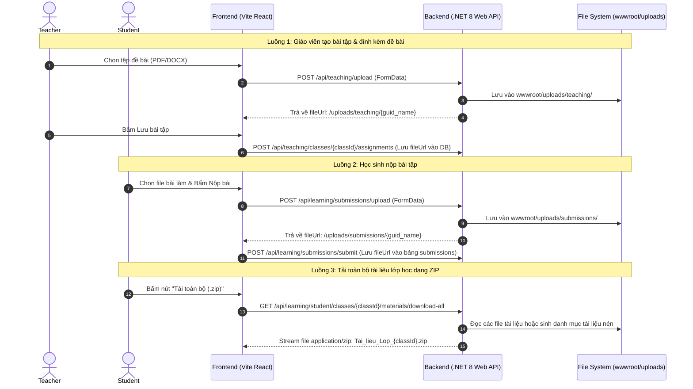

# KIẾN TRÚC LƯU TRỮ VÀ TỔ CHỨC FILE TÀI LIỆU TRÊN SERVER (BACKEND)

Tài liệu này mô tả chi tiết vị trí lưu trữ, cấu trúc thư mục, quy tắc đặt tên và các API Endpoint liên quan đến tính năng tải lên (upload) và tải xuống (download) tài liệu học tập, bài tập và bài nộp trong hệ thống **EduTrack**.

---

## 1. Vị trí lưu trữ vật lý trên Server Backend

Hệ thống lưu trữ toàn bộ các tệp tĩnh được tải lên bên trong thư mục `wwwroot/uploads/` của dự án Backend (`Capstone2/backend/wwwroot/uploads/`).

### Cấu trúc cây thư mục và Danh sách tài liệu mẫu có sẵn:

```
Capstone2/backend/wwwroot/
└── uploads/
    ├── teaching/                                       # Tài liệu đề bài, học liệu do Giáo viên tạo khi giao bài tập
    │   ├── hw01_math9.pdf                              # Đề bài tập về nhà 01 (Phương trình bậc 2 - Toán 9)
    │   ├── quiz01_math9.pdf                            # Đề kiểm tra 15 phút (Định lý Viète - Toán 9)
    │   ├── lab01_phys9.pdf                             # Báo cáo thực hành chuyển động biến đổi đều (Vật lý 9)
    │   ├── assignment_default.pdf                      # Tệp đề bài mẫu mặc định
    │   ├── Bai_tap_phuong_trinh_bac_2.pdf              # Phiếu bài tập chuyên đề
    │   ├── Vi_du_minh_hoa.docx                         # Tài liệu ví dụ minh họa phương pháp giải
    │   └── De_cuong_on_tap_chuong1.pdf                 # Đề cương ôn tập chương
    │
    ├── submissions/                                    # Bài làm của Học sinh nộp lên cho bài tập
    │   ├── stu001_hw01.pdf                             # Bài làm học sinh Lê Văn An (Điểm 9.5)
    │   ├── stu002_hw01.pdf                             # Bài làm học sinh Trần Thị Bích (Điểm 8.0)
    │   ├── stu003_hw01.pdf                             # Bài làm học sinh Nguyễn Văn Cường
    │   ├── Bai_lam_LeVanAn.pdf                         # Tệp nộp bài tập mẫu học sinh
    │   ├── Bai_nop_HS6_Asg1.pdf                        # Tệp nộp bài theo định dạng hệ thống
    │   └── edutrack_ai_architecture_3e9822bb.png       # Tệp hình ảnh bài làm nộp thử nghiệm
    │
    └── materials/                                      # Học liệu bài giảng, tài liệu chuyên đề theo lớp học
        ├── Chapter_1_Quadratic_Equations_and_Systems.pdf # Chương 1: Phương trình bậc 2 & Hệ thức (Toán 9)
        ├── Lesson_1.1_Solving_Quadratic_Equations.docx # Bài 1.1: Phương pháp giải PT bậc 2 (Toán 9)
        ├── Lesson_1.2_Vieta_Formulas_and_Applications.pdf # Bài 1.2: Định lý Vi-et và ứng dụng (Toán 9)
        ├── Chapter_2_Plane_Trigonometry.pdf            # Chương 2: Lượng giác phẳng (Toán 9)
        ├── Chapter_1_Kinematics_and_Motion.pdf         # Chương 1: Động học và chuyển động (Vật lý 9)
        ├── Motion_Sensor_Experiment_Instructions.docx  # Hướng dẫn thí nghiệm cảm biến chuyển động (Vật lý 9)
        └── Slide_Newton_Laws_and_Acceleration.pptx     # Slide Định luật Newton và Gia tốc (Vật lý 9)
```

---

## 2. Bảng quy ước lưu trữ và quyền hạn theo Vai trò (Roles)

| Thư mục lưu trữ | Vai trò Upload | Vai trò Download / Xem | Mô tả chi tiết |
| :--- | :--- | :--- | :--- |
| `wwwroot/uploads/teaching/` | **Teacher** | Teacher, TA, Student | Tệp đính kèm khi giáo viên tạo bài tập (đề bài, file tài liệu hướng dẫn mẫu). |
| `wwwroot/uploads/submissions/` | **Student** | Student, Teacher, TA | Bài làm do học sinh tải lên khi nộp bài tập. Giáo viên và Trợ giảng có thể xem/tải trực tiếp từ bảng chấm bài. *(Phụ huynh chỉ xem điểm số, không xem bài nộp).* |
| `wwwroot/uploads/materials/` | **Teacher, Center** | Teacher, TA, Student, Parent | Tài liệu bài giảng, giáo trình, slide môn học theo từng lớp. Hỗ trợ **tải từng tệp lẻ** hoặc **tải toàn bộ gói dạng .ZIP**. |

---

## 3. Quy tắc đặt tên tệp (Naming Convention)

Để tránh xung đột tên tệp khi nhiều người dùng tải lên các file trùng tên (ví dụ: `baitap.pdf`, `tailieu.docx`), hệ thống áp dụng cơ chế sinh tên duy nhất:

1. **Chuẩn hóa tên gốc (Sanitization):** Loại bỏ ký tự đặc biệt, thay thế khoảng trắng bằng dấu gạch dưới `_`.
2. **Tiền tố GUID/UUID:** Gắn mã ngẫu nhiên 32 ký tự trước tên tệp:
   - *Công thức:* `{Guid.NewGuid():N}_{cleanFileName}`
   - *Ví dụ:* `a1f9e23b4c12_De_Thi_Toan_Chuyen_Lop9.pdf`
3. **Đường dẫn URL trả về Client:**
   - Dạng đường dẫn tương đối qua backend static proxy:
     - `/uploads/teaching/{uniqueFileName}`
     - `/uploads/submissions/{uniqueFileName}`

---

## 4. Danh sách các API Endpoints Upload & Download

### 4.1. Tải lên tệp (Upload Endpoints)

| Phương thức | Endpoint | Vai trò | Chức năng | Định dạng hỗ trợ | Giới hạn dung lượng |
| :--- | :--- | :--- | :--- | :--- | :--- |
| `POST` | `/api/teaching/upload` | Teacher | Tải tệp đề bài / học liệu khi tạo bài tập | `.pdf, .doc, .docx, .ppt, .pptx, .xls, .xlsx, .zip, .png, .jpg` | Tối đa 25 MB |
| `POST` | `/api/learning/submissions/upload` | Student | Tải tệp bài nộp bài tập | `.pdf, .doc, .docx, .ppt, .pptx, .xls, .xlsx, .zip, .rar, .png, .jpg` | Tối đa 30 MB |

### 4.2. Tải xuống / Xem tệp (Download Endpoints)

| Phương thức | Endpoint | Vai trò | Chức năng |
| :--- | :--- | :--- | :--- |
| `GET` | `/uploads/teaching/{fileName}` | Mọi vai trò (qua proxy) | Tải / xem trực tiếp file đề bài |
| `GET` | `/uploads/submissions/{fileName}` | Teacher, TA, Student | Tải / xem trực tiếp bài làm học sinh đã nộp |
| `GET` | `/api/learning/student/classes/{classId}/materials/{materialId}/download` | Student, Parent | Tải tệp tài liệu học tập đơn lẻ của lớp |
| `GET` | `/api/learning/student/classes/{classId}/materials/download-all` | Student, Parent | **Tải hàng loạt (Bulk Download):** Hệ thống tự động đóng gói toàn bộ tài liệu của lớp vào 1 tệp `.zip` kèm danh mục mục lục `00_README_Danh_Muc_Tai_Lieu.txt` |

---

## 5. Luồng tương tác Frontend - Backend


