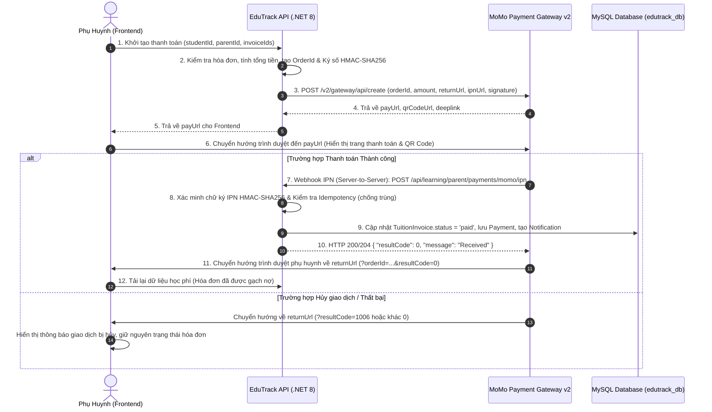

# Hướng Dẫn & Kiến Trúc Tích Hợp Cổng Thanh Toán MoMo (Parent Tuition Payment)

Tài liệu này lưu trữ toàn bộ ý tưởng thiết kế, luồng nghiệp vụ (Workflow), đặc tả kỹ thuật API và lộ trình triển khai chi tiết cho tính năng **Thanh toán học phí trực tuyến qua Ví MoMo** dành cho Phụ huynh trong hệ thống **EduTrack**.

---

## 1. Tổng quan & Mục tiêu nghiệp vụ

- **Bounded Context**: `Learning` (Phân hệ Học tập & Cổng Phụ huynh - Thành viên 3).
- **Đối tượng sử dụng**: Phụ huynh học sinh (`Role: parent`).
- **Mục tiêu**:
  - Cho phép Phụ huynh đóng học phí cho con trực tuyến một cách tự động, nhanh chóng và minh bạch.
  - Sau khi thanh toán thành công, hệ thống tự động gạch nợ hóa đơn (`TuitionInvoice.Status = 'paid'`), tạo chứng từ giao dịch (`Payment`), và gửi thông báo xác nhận (`Notification`) cho cả Phụ huynh và Học sinh.
  - Giảm thiểu công việc đối soát sao kê thủ công của bộ phận Kế toán / Giáo vụ trung tâm.

---

## 2. Sơ đồ Luồng Nghiệp Vụ (Architecture & Sequence Workflow)



---

## 3. Đặc tả Kỹ thuật MoMo API Gateway v2

### 3.1. Cấu hình Môi trường Thử nghiệm (Sandbox Credentials)
- **Partner Code**: `MOMOBKUN20180529`
- **Access Key**: `klm05TvNBzhg7h7j`
- **Secret Key**: `at67qH6mk8w5Y1nAyMoYKMWACiEi2bsa`
- **Create Payment API**: `https://test-payment.momo.vn/v2/gateway/api/create`
- **Query Transaction API**: `https://test-payment.momo.vn/v2/gateway/api/query`
- **Return URL (Client)**: `http://localhost:5173/parent/tuition`
- **IPN URL (Server Webhook)**: `http://localhost:5036/api/learning/parent/payments/momo/ipn`

### 3.2. Thuật toán Ký số (HMAC-SHA256 Signature)
MoMo yêu cầu sắp xếp các trường dữ liệu theo thứ tự bảng chữ cái (alphabetical order) thành một query-string rồi băm bằng `secretKey`.

#### A. Chữ ký tạo thanh toán (Create Signature):
```text
accessKey=$accessKey&amount=$amount&extraData=$extraData&ipnUrl=$ipnUrl&orderId=$orderId&orderInfo=$orderInfo&partnerCode=$partnerCode&redirectUrl=$redirectUrl&requestId=$requestId&requestType=$requestType
```

#### B. Chữ ký xác thực Webhook IPN (IPN Verify Signature):
```text
accessKey=$accessKey&amount=$amount&extraData=$extraData&message=$message&orderId=$orderId&orderInfo=$orderInfo&orderType=$orderType&partnerCode=$partnerCode&payType=$payType&requestId=$requestId&responseTime=$responseTime&resultCode=$resultCode&transId=$transId
```

#### C. Chữ ký truy vấn trạng thái đơn hàng (Query Signature):
```text
accessKey=$accessKey&orderId=$orderId&partnerCode=$partnerCode&requestId=$requestId
```

---

## 4. Mô hình Dữ liệu & Lưu vết Database (Database Persistence)

Khi thanh toán thành công qua MoMo, hệ thống cập nhật các bảng sau:

1. **Bảng `tuition_invoices`**:
   - `status`: Chuyển từ `'unpaid'` sang `'paid'`.
2. **Bảng `payment`**:
   - `invoice_id`: ID hóa đơn tương ứng.
   - `amount`: Số tiền học phí đã nộp.
   - `payment_method`: `'momo'`.
   - `transaction_code`: Ghi nhận mã giao dịch MoMo, ví dụ `'MOMO-98765432101'`.
   - `paid_at`: Thời điểm thanh toán (UTC/GMT+7).
   - `paid_by_user_id`: ID của Phụ huynh thực hiện thanh toán (`parentId`).
   - `note`: Nội dung chuyển khoản ghi chú tự động.
3. **Bảng `notifications` & `notification_recipients`**:
   - Tạo thông báo hệ thống loại `'tuition'`.
   - Gửi đến cả Phụ huynh và Học sinh để xác nhận việc đóng học phí đã hoàn tất.

---

## 5. Lưu ý quan trọng khi kiểm thử (Testing & Limitations)

> [!WARNING]
> **Vấn đề quét mã QR bằng App MoMo thật trên điện thoại cá nhân:**
> - Server **MoMo Sandbox (`test-payment.momo.vn`)** và **MoMo Production (Thật)** là hai hệ thống hoàn toàn độc lập.
> - Nếu bạn mở app MoMo thật trên điện thoại để quét mã QR của môi trường Sandbox, app MoMo thật sẽ báo lỗi **"Mã hết hạn hoặc không tồn tại"**.
> - Do đó, trên giao diện web MoMo sẽ không nhận được tín hiệu thanh toán thành công và không tự động redirect về web EduTrack.

### Các giải pháp kiểm thử khi phát triển tiếp:
1. **Giải pháp 1 - Dùng App MoMo Test**: Tải ứng dụng MoMo Developer Sandbox từ `https://test-payment.momo.vn/download/`, đăng nhập bằng số điện thoại test của MoMo (OTP mặc định `000000`). Khi quét bằng app này, tiền ảo trong ví test sẽ bị trừ và web tự động redirect về ngay lập tức.
2. **Giải pháp 2 - Tạo "Sandbox Simulator" (Khuyên dùng khi Demo cho hội đồng)**:
   - Trong quá trình phát triển, xây dựng một nút bấm nhỏ trên thanh điều hướng hoặc modal: *"Mô phỏng MoMo thanh toán thành công"*.
   - Nút này sẽ gọi thẳng vào endpoint `/momo/confirm` hoặc giả lập IPN để gạch nợ hóa đơn thật trên database, giúp buổi demo diễn ra trơn tru mà không cần người xem phải cài thêm app test vào điện thoại.
3. **Giải pháp 3 - Chuyển sang Cổng VietQR Napas (Nếu muốn quét bằng App Ngân hàng thật)**:
   - Tạo mã VietQR động theo chuẩn Napas với số tài khoản ngân hàng trung tâm, số tiền cố định và nội dung `EDUTRACK HP <MãHọcSinh>`.
   - Khi đó, bất kỳ App Ngân hàng thật nào (Vietcombank, MB, Techcombank...) hoặc ví MoMo thật đều quét và nhận diện được số tiền ngay.

---

## 6. Lộ trình triển khai khi tiếp tục tính năng (Next Development Steps)

Khi nhóm quyết định kích hoạt lại tính năng này, hãy tiến hành theo các bước sau:

1. **Bước 1: Cấu hình `appsettings.json`**:
   Thêm khối `"MoMo"` với các khóa API Sandbox hoặc Production do MoMo cấp.
2. **Bước 2: Backend Core**:
   - Tạo `MomoSecurityHelper.cs` (HMAC-SHA256).
   - Tạo `MomoPaymentDtos.cs` chứa các DTOs yêu cầu và phản hồi.
   - Tạo `IMomoPaymentService` và `MomoPaymentService.cs` (gọi HTTP đến MoMo và gạch nợ hóa đơn trong DbContext).
   - Đăng ký `services.AddHttpClient<IMomoPaymentService, MomoPaymentService>()` trong `LearningServiceExtensions.cs`.
3. **Bước 3: Controller Endpoints**:
   - Thêm các endpoint vào `ParentPortalController.cs`:
     - `POST /api/learning/parent/payments/momo/create`
     - `POST /api/learning/parent/payments/momo/ipn`
     - `POST /api/learning/parent/payments/momo/confirm`
4. **Bước 4: Frontend UI & Client**:
   - Thêm phương thức gọi API trong `learningApi.ts` và `learningDAL.ts`.
   - Cập nhật `TuitionPaymentModal.tsx` để người dùng chọn phương thức Ví MoMo.
   - Thêm `useEffect` lắng nghe query string trên `ParentTuitionPage.tsx` để xử lý khi MoMo redirect quay về.
