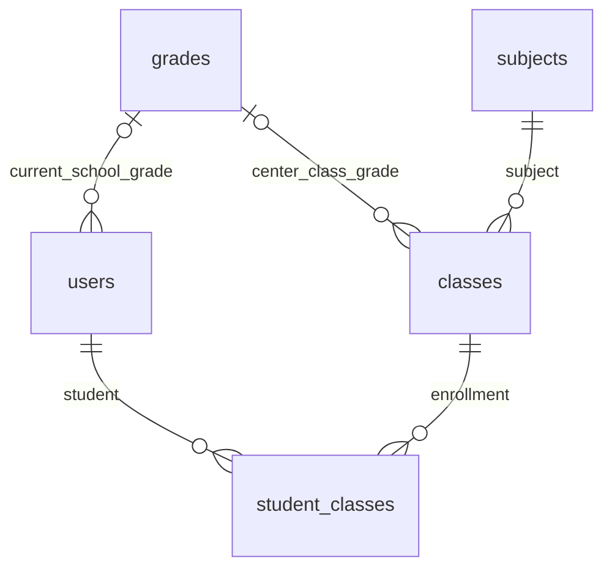

# Task 03 — Quyết định Student Grade và review triển khai MySQL

> Cập nhật cuối: HTTP smoke development đạt 8/8 API đọc, backend/integration/HTTP đạt 85 assertion và browser API thật đạt 6 nhóm trên MySQL test riêng. Không chạy lại migration development. Xem [báo cáo tổng hợp Task 03](EDUTRACK_TASK03_FINAL_REPORT.md); các điểm dừng/chờ kiểm tra bên dưới là lịch sử.

**Trạng thái mới nhất 07/11/2026, 16:00:** đã được phê duyệt và áp dụng đúng AddStudentGrade sau backup/restore-test; postflight đạt, dữ liệu cũ giữ nguyên. Backend đang chạy localhost:5036 với seeder opt-out. Chưa gọi API smoke test vì lỗi đọc log làm dừng pipeline. Xem [biên bản kết quả thực tế](EDUTRACK_TASK03_DATABASE_MIGRATION_RESULT.md). Những trạng thái chưa phê duyệt/chưa migration bên dưới là lịch sử trước lượt triển khai này.

Ngày kiểm tra: 07/11/2026, Asia/Bangkok.

**Cập nhật kiểm tra quyền 15:48:** guard đã được sửa và preflight chỉ đọc đạt; không phát hiện quyền nguồn thiếu. Backup/restore/migration vẫn chưa chạy; quyền restore phải xác minh riêng. Chi tiết tại [báo cáo validation quyền MySQL](EDUTRACK_TASK03_MYSQL_PRIVILEGE_VALIDATION.md).

**Cập nhật 07/11/2026, 15:30: người dùng đã phê duyệt migration có điều kiện; lượt triển khai đã dừng tại kiểm tra quyền của preflight, chưa backup hoặc chạy DDL. Backend EduTrack đang dừng.** Xem [biên bản thao tác database](EDUTRACK_TASK03_DATABASE_EXECUTION.md) để biết nguyên nhân và trạng thái từng bước. Các phần bên dưới ghi lại kết quả review/test và kế hoạch trước khi được phê duyệt, không phải bằng chứng migration đã chạy trên database phát triển. Không commit/push/merge.

## 1. Ý nghĩa nghiệp vụ đã chốt

| Quan hệ | Ý nghĩa | Nơi lưu |
| --- | --- | --- |
| Student–Grade | Khối phổ thông hiện tại của Student, không phụ thuộc đăng ký học thêm. | `users.grade_id` nullable, FK tới `grades.grade_id`. |
| Class–Grade | Khối của lớp học thêm do trung tâm tổ chức. | `classes.grade_id`, giữ nguyên thiết kế Task 02. |
| Student–Class | Những lớp học thêm đã đăng ký và lịch sử tham gia. | `student_classes`, giữ nguyên các cột và quan hệ. |
| Class–Subject | Mỗi Class liên kết một Subject. | `classes.subject_id`, không tạo Class Subject hoặc Class đa môn. |

Student chưa đăng ký lớp vẫn có thể lưu Grade. Student hiện ở Khối 8 có thể có lịch sử học Class Khối 7, hoặc vẫn còn các enrollment thuộc khối khác. Đây là dữ liệu hợp lệ theo các ý nghĩa độc lập, không phải xung đột cần tự sửa.



Sơ đồ chỉ trích phần liên quan; User vẫn là bảng dùng chung nhiều role. Grade của hồ sơ được API kiểm tra chỉ áp dụng cho Student, không thêm actor hoặc thay Authentication/Authorization.

## 2. Vì sao mở rộng so với Capstone I

Báo cáo Capstone I trong `docs/CSW480_EDUTRACK ... Ung Van Giau.docx`, Hình 5 và các Bảng 8, 12, 15, có User–Class qua enrollment và mỗi Class một Subject; không có `users.grade_id`. `users.specialty` được mô tả là chuyên môn giáo viên. Vì vậy không ghi nhận quan hệ mới như một phần đã có sẵn trong ERD gốc.

Quyết định hiện tại bổ sung một thuộc tính nghiệp vụ độc lập: **khối phổ thông hiện tại**, có thể có trước khi Student ghi danh. Suy luận khối này từ các Class không đáp ứng đúng ý nghĩa vì Student có thể chưa có enrollment hoặc có nhiều lớp/lịch sử ở các khối khác nhau. Ghi ID vào `specialty` hoặc `center_settings` cũng làm sai ý nghĩa trường cũ và không có FK rõ ràng.

Phần mở rộng được giới hạn ở một cột, một index và một FK. Không thêm Student profile table, bảng lịch sử Grade, bảng Class Subject, dữ liệu học kỳ hoặc quan hệ Tuition mới. Có thể dùng sơ đồ/quyết định này để cập nhật phần thay đổi thiết kế trong báo cáo Capstone II.

Lợi ích:

- Lưu và lọc Student theo khối phổ thông thật, kể cả chưa ghi danh.
- Tên khối phản ánh catalogue Grade hiện tại; đổi tên Grade không phải sửa từng Student.
- Cập nhật hồ sơ khi lên khối không phá hủy hoặc diễn giải lại lịch sử học thêm.
- Không tạo Class/enrollment giả chỉ để biểu diễn Grade.

Giới hạn:

- Chỉ lưu một Grade hiện tại; không lưu lịch sử thay đổi khối phổ thông hoặc năm học. Enrollment không được dùng làm lịch sử lên khối của trường phổ thông.
- Nullable để bảo toàn Student cũ và luồng tạo hồ sơ chưa xác định khối. Không tự backfill từ `specialty` hoặc Class.
- Cùng dùng catalogue `grades`; không mặc định Grade ID bằng số năm học và không hardcode dải ID 1–12. Việc quản lý tên danh mục phải phù hợp ý nghĩa nghiệp vụ đã chốt.

## 3. Điều chỉnh source và validation

### Add Student

Tiếp tục dùng `POST /api/users/students`:

1. Lưu Grade ID trong User, kể cả `classIds: []`.
2. Nếu có Class được chọn, bắt buộc chúng tồn tại, thuộc Grade đang chọn và có trạng thái nhận ghi danh (`active`/`upcoming`).
3. Dùng transaction và các unique index sẵn có để tạo User, role và enrollment nhất quán; không tạo Invoice/Payment/Class/Subject.
4. Các cơ chế retry/chống tạo Student trùng của Task 03 được giữ nguyên.

### Edit Student

Tiếp tục dùng `PUT /api/users/{id}`. Đã bỏ toàn bộ truy vấn `student_classes` để xét xung đột Grade trong `UserRepository.UpdateUserWithRoleAsync()`.

- Grade được gửi phải tồn tại và hồ sơ phù hợp role Student.
- Chỉ cập nhật Grade hồ sơ cùng các thông tin User đang được sửa.
- Không chặn theo enrollment đang học, `dropped`, `completed` hoặc lịch sử khác khối.
- Không INSERT/UPDATE/DELETE StudentClass, không chuyển lớp hay sửa ngày/lý do nghỉ lớp.
- Bỏ qua field `gradeId` trong JSON: giữ nguyên Grade; gửi `null`: bỏ giá trị Grade nullable, enrollment vẫn giữ nguyên.
- Giá trị `specialty` cũ của Student vẫn giữ nguyên. Tên Grade đọc qua FK, không qua chuỗi này.

Giao diện Edit chung cho hai role có chú thích rằng đây là khối phổ thông hiện tại và thay đổi không điều chỉnh các lớp đã ghi danh. Filter/sorting/chi tiết Student tiếp tục dùng Grade của hồ sơ.

## 4. Review migration `20261107061101_AddStudentGrade`

File migration **không thay đổi nội dung** sau review:

```text
SHA-256: AFE6E7C2232E3679C2F61A37E06EFC38AF583F69550B3B407ED5405A2A0C6A2F
```

`Up` có đúng ba operation:

| Operation | Thành phần |
| --- | --- |
| AddColumn | `users.grade_id INT NULL`, không default, không computed value/backfill. |
| CreateIndex | `IX_users_grade_id`, một cột Grade ID, không unique. |
| AddForeignKey | `FK_users_grades_grade_id` tới `grades.grade_id`, `ON DELETE RESTRICT`. |

EF ghi thêm đúng migration này vào history. Không có CREATE/DROP bảng nghiệp vụ, seed Grade, UPDATE/DELETE User hoặc sửa enrollment/Tuition. Index và FK chỉ phục vụ quan hệ mới; không đặt constraint buộc Grade hồ sơ bằng Grade của mọi Class.

`Down` có đúng ba operation đảo schema: bỏ FK, index và cột mới. **Down có thể mất Grade đã gán, nên không phải phương án khôi phục mặc định sau khi có dữ liệu mới.**

Đã chuẩn bị SQL review tại `Capstone2/db/migrations/AddStudentGrade.review.sql`, sinh offline từ đúng migration nền đến đúng migration đích. File có cảnh báo chưa phê duyệt và không được thực thi trong task này. `START TRANSACTION` trong SQL EF không làm MySQL DDL trở thành transaction có thể rollback đầy đủ.

## 5. Tương thích với database hiện tại — kiểm tra chỉ đọc

Đã chạy bản preflight chỉ đọc, không khởi động API/DbSeeder, không đọc hoặc ghi bản ghi cá nhân để kiểm thử. Thông tin kết nối chỉ dùng trong bộ nhớ/child environment, không đưa mật khẩu vào command line hoặc báo cáo.

| Điều kiện | Kết quả snapshot preflight |
| --- | --- |
| Migration history | Có đúng 6 migration đã review, cuối cùng `20261107002822_AddGradeClassification`. |
| Migration đích | Chưa có trong history. |
| Bảng `users`, `grades` | Đều InnoDB. |
| PK `users.user_id`, `grades.grade_id` | Signed INT, NOT NULL, kiểu phù hợp FK mới. |
| `users.grade_id` | Chưa tồn tại. |
| Tên index/FK mới | Chưa tồn tại trong schema. |
| Số dòng tại snapshot | users 11; grades 14; student_classes 5; tuition_invoices 11; payment 9. |

Các số dòng là thông tin quan sát, không phải giá trị hardcode và không chứng minh ứng dụng đã ngừng ghi. Bản migration không sửa 14 Grade đang có và không giả định catalogue chỉ có 12 dòng. Phải chạy lại preflight ngay trong cửa sổ bảo trì sau khi được phê duyệt; các thao tác ngoài phiên này có thể làm trạng thái thay đổi.

Script: `Capstone2/db/migrations/AddStudentGrade.preflight.readonly.sql`. Nó chỉ có SELECT và transaction/session ở chế độ READ ONLY; kết thúc bằng ROLLBACK. Các dòng BLOCK yêu cầu dừng review, không tự điều chỉnh hoặc áp dụng migration khác.

## 6. Kế hoạch trước khi áp dụng database chính

Đây là **kế hoạch chưa thực thi**, cần phê duyệt riêng của người dùng.

1. Chốt server/schema và đối chiếu server UUID với đích được duyệt. Chốt hash source/migration/SQL review. Không dùng `first_script.sql` để nâng cấp vì script đó có DROP/seed.
2. Chọn cửa sổ bảo trì; dừng đúng các tiến trình ứng dụng được thống nhất để ngăn ghi trong thời gian dump/DDL/postflight. Xác nhận không còn transaction ghi hoặc DDL khác; không tự dừng MySQL hay tiến trình không xác định.
3. Chạy lại preflight: baseline 6 migration, InnoDB, kiểu khóa, thành phần mới đều vắng mặt, quyền ALTER/INDEX/REFERENCES cần thiết và không có thay đổi ngoài review.
4. Tạo backup logic riêng tư của toàn schema, gồm schema/data, triggers/routines/events và migration history. Không đưa backup hay credential vào Git. Ghi SHA-256 và giữ một bản sao riêng trước khi thực thi DDL.
5. Restore-test backup trên **instance MySQL độc lập**, xác minh đúng port/server/data directory test; không restore thử lên main. Đối chiếu schema, số dòng và fingerprint dữ liệu; tách cấu hình API test để không trỏ về main.
6. Chỉ khi backup đã kiểm chứng, thực thi đúng `AddStudentGrade.review.sql`, không tự chạy tất cả pending migrations. Dùng chế độ dừng khi lỗi, không `--force`; đặt thời gian chờ metadata lock phù hợp. Không auto-retry các ALTER sau lỗi.
7. Postflight trước mở ghi lại: column nullable signed INT, index đúng, FK RESTRICT đúng, history thêm đúng một dòng. Kiểm tra mọi giá trị cột cũ/enrollment không đổi, Grade của hồ sơ cũ còn NULL; không phát sinh Invoice/Payment hoặc seed ngoài review.
8. Dùng API mới đã build, kiểm tra GET Users/Grades/Class/Settings/Tuition/Payment rồi kiểm thử UI hai role. Không dùng API GET Teaching có khả năng tự seed dữ liệu để làm smoke test. Chỉ mở lại ghi sau khi postflight đạt.

Ví dụ lệnh backup để review sau phê duyệt; đây không phải lệnh đã chạy trên main:

```text
mysqldump --defaults-extra-file="<private-client.cnf>" --single-transaction --routines --triggers --events --hex-blob --set-gtid-purged=OFF --no-tablespaces --default-character-set=utf8mb4 --result-file="<private-backup.sql>" "<approved-schema>"
```

File cấu hình client riêng tư không được commit hoặc in mật khẩu. Trong thời gian `--single-transaction` phải tránh DDL đồng thời; backup không thay thế việc bảo trì/ngăn ghi cần thiết cho kiểm chứng trước–sau. Restore được thực hiện trên instance riêng và phải kiểm tra các câu USE/tên schema trong dump trước khi nạp.

## 7. Kế hoạch khôi phục theo tình huống

| Tình huống | Phương án an toàn |
| --- | --- |
| Preflight/backup/restore-test không đạt | Không chạy DDL. Giữ trạng thái main và báo nguyên nhân. |
| DDL lỗi giữa chừng, history chưa ghi nhận | Giữ ứng dụng ngừng ghi; chụp trạng thái cột/index/FK/history và lỗi. Không coi ROLLBACK SQL là đã hoàn tác, không chạy lại nguyên script hoặc tự DROP thành phần. Trình phương án sửa tiếp/khôi phục theo trạng thái thực tế để phê duyệt. |
| Schema đã nâng cấp nhưng cần lùi bản ứng dụng | Ưu tiên giữ cột nullable/index/FK và dùng bản ứng dụng tương thích đã kiểm thử. Không tự làm mất dữ liệu Grade mới. |
| Cần Down và chưa có Grade hồ sơ nào được gán | Chỉ sau backup đã kiểm chứng, xác nhận toàn bộ `users.grade_id IS NULL`, không có ghi đồng thời và được duyệt Down. Đã diễn tập tình huống này trên test. |
| Cần Down sau khi đã gán Grade | Backup toàn trạng thái **sau nâng cấp**, xuất mapping `user_id → grade_id`, xác minh restore và lập kế hoạch giữ dữ liệu phát sinh. Không tự Down hay restore backup cũ đè lên main. |
| Phải khôi phục đầy đủ database | Restore vào instance/schema riêng để xác minh trước; chuyển đổi hoặc restore main chỉ theo phê duyệt cụ thể. Nếu đã có giao dịch mới, phải thống nhất cách phục hồi chúng, không mặc định chấp nhận mất dữ liệu sau backup. |

Chưa tạo backup main hoặc diễn tập restore dữ liệu thật. Bộ test dùng dữ liệu tổng hợp để chứng minh phương pháp, không thay thế backup/restore-test của snapshot thật trong cửa sổ được duyệt.

## 8. Kết quả build/test

Frontend kiểm tra trên bản sao source riêng không chứa `.env`, dùng Node 24.19.0 và cài sạch từ lockfile. Backend build bằng SDK 8.0.427 ra thư mục tạm; không restart ứng dụng chính.

| Kiểm tra | Kết quả |
| --- | --- |
| `npm ci`, lint, typecheck, build | Đạt; lint 0 error, 190 warning cũ; còn cảnh báo bundle trên 500 kB. |
| Frontend unit/contract | 96 pass, không fail/skip. |
| Chrome browser với API fixture | 12 nhóm kịch bản đạt: hai role × ba viewport × enrollment regression/Grade-link. Edit của Student có enrollment khác khối được lưu, refresh giữ Grade mới, danh sách enrollment giữ nguyên. |
| Backend API + harness, SDK 8 | Đạt; còn các warning CS8601 cũ ở API và NU1900 khi NuGet audit không truy cập dịch vụ. Không thêm warning C# mới trong harness. |
| Harness mặc định, không DB | 26 assertion đạt, gồm kiểm tra migration có đúng ba operation Up/Down cần thiết. |
| Tuition harness hiện có | 18 assertion đạt, không truy cập database. |
| MySQL riêng `127.0.0.1:33308` | 73 assertion đạt; schema tên ngẫu nhiên và dữ liệu giả, không đọc connection string ứng dụng. |
| SQL review | Sinh offline từ đúng migration trước đến đúng migration đích; không thực thi main. |
| `git diff --check` và `actionlint` | Đạt. |

Kiểm thử MySQL gồm:

- Áp dụng migration nền rồi thêm profile, Class và lịch sử enrollment tổng hợp trước khi chạy migration mới.
- So sánh fingerprint tất cả giá trị cột gốc của các bảng nghiệp vụ trước–sau, bỏ qua cột Grade mới và thay đổi history có chủ đích.
- Xác minh EF model/snapshot không còn khác biệt.
- Diễn tập Down/Up khi chưa gán Grade, xác nhận dữ liệu cũ vẫn nguyên vẹn.
- Lưu Student có Grade nhưng không có Class; giữ validation Add Class sai Grade và rollback khi enrollment lỗi.
- Edit Grade qua repository/service/controller, đọc lại bằng DbContext mới; lưu Grade khác các lớp active/dropped/completed và giữ đúng mọi trường `ScId`, Student/Class ID, ngày ghi danh, trạng thái, ngày/lý do nghỉ.
- Dump dữ liệu test đã gán Grade bằng native `mysqldump`, restore sang schema test khác, so fingerprint tất cả dữ liệu (gồm Grade) và xác nhận migration history được phục hồi.
- Giữ các kiểm thử liên kết phụ huynh và retry/chống trùng hiện có. Các schema/instance test được dọn và dừng sau kiểm tra.

Browser dùng fixture; MySQL harness dùng production code với database thật độc lập. Chưa kiểm thử browser qua HTTP API thật trên main hoặc đăng nhập tài khoản thật. Chưa có GitHub Actions run cho source chưa commit này.

## 9. File thay đổi trong lần chốt quy tắc

- `Capstone2/backend/Repositories/Implementation/UserRepository.cs`: bỏ validation xung đột enrollment khỏi Edit Grade.
- `Capstone2/backend/Models/Entities/User.cs`: giải thích ý nghĩa khối phổ thông hiện tại.
- `Capstone2/frontend/src/GUIs/pages/admin/shared/StudentManagementPage.tsx`: hướng dẫn người dùng khi sửa Grade.
- `Capstone2/frontend/tests/studentEnrollment.browser.mjs`: kiểm thử Edit thành công và giữ enrollment, thay kỳ vọng báo xung đột cũ.
- `Capstone2/backend.Tests/StudentEnrollment/Program.cs`: snapshot enrollment, review migration, Down/Up và backup/restore rehearsal.
- `Capstone2/backend.Tests/StudentEnrollment/Run-IsolatedMySql.ps1`: chuyển đường dẫn MySQL test cho dump/restore helper.
- `Capstone2/db/migrations/AddStudentGrade.preflight.readonly.sql`: preflight chỉ đọc.
- `Capstone2/db/migrations/AddStudentGrade.review.sql`: SQL migration để review, chưa được phép chạy main.
- `docs/EDUTRACK_TASK03_GRADE_LINK_FIX.md`, `docs/EDUTRACK_TASK03_STUDENT_ENROLLMENT.md`: cập nhật/tham chiếu quy tắc mới, loại bỏ mô tả chặn Edit Grade theo lịch sử.
- `docs/EDUTRACK_TASK03_STUDENT_GRADE_DECISION.md`: quyết định kiến trúc, kết quả và kế hoạch này.

## 10. Rủi ro còn lại và bước chờ phê duyệt

1. **Schema chính chưa có `users.grade_id`.** Bản backend mới vẫn không tương thích schema đó; các truy vấn Include User có thể trả 500. Không yêu cầu người dùng chạy lại backend để thay cho migration, và không tự áp dụng migration để chữa lỗi.
2. MySQL DDL có implicit commit và metadata lock; có thể cần xử lý trạng thái nâng cấp một phần nếu gặp lỗi. Backup/restore-test và maintenance window là điều kiện trước áp dụng.
3. Grade cũ trong specialty không được tự diễn giải thành khối phổ thông hiện tại. Sau nâng cấp, các profile cũ cần người dùng xác nhận Grade khi sửa; backfill hàng loạt là công việc khác cần review.
4. Một số luồng cũ ngoài Task 03 có khả năng seed dữ liệu khi khởi động/đọc Teaching. Chúng không được sửa trong lần này; cần kiểm soát khi lên kế hoạch smoke test và ngăn ghi.

**Chờ người dùng xem báo cáo và phê duyệt riêng thao tác database.** Chưa chạy migration trên main, chưa backfill, chưa commit/push/merge.
