# EduTrack: Sơ Đồ Cấu Trúc Cơ Sở Dữ Liệu & Quan Hệ Thực Thể (ERD Visual - 22 Tables)

> **Tài liệu tham chiếu:** `Capstone2/db/first_script.sql`  
> **Phiên bản:** Master Capstone 2 (Chốt đúng 22 bảng: 21 Bảng gốc đã tối ưu + 1 Bảng mới `parent_students`)  
> **Hệ quản trị CSDL:** MySQL 8.0+  

---

## 1. Sơ Đồ Thực Thể Quan Hệ Tổng Thể (Comprehensive Mermaid ERD - 22 Bảng)

```mermaid
erDiagram
    %% ==========================================
    %% 1. USER & ROLE MANAGEMENT & PARENT LINK
    %% ==========================================
    users ||--o{ user_roles : "has"
    roles ||--o{ user_roles : "assigned_to"
    users ||--o{ parent_students : "as_parent"
    users ||--o{ parent_students : "as_student"

    %% ==========================================
    %% 2. ACADEMIC, CLASSES & ENROLLMENT
    %% ==========================================
    subjects ||--o{ classes : "categorizes"
    classes ||--o{ teacher_classes : "instructed_in"
    users ||--o{ teacher_classes : "teaches"
    classes ||--o{ ta_classes : "assisted_in"
    users ||--o{ ta_classes : "assists"
    classes ||--o{ student_classes : "enrolled_in"
    users ||--o{ student_classes : "studies"

    %% ==========================================
    %% 3. SCHEDULING, SESSIONS & ATTENDANCE
    %% ==========================================
    classes ||--o{ class_schedules : "scheduled_in"
    classes ||--o{ class_sessions : "conducts"
    class_schedules ||--o{ class_sessions : "generates"
    classes ||--o{ content_units : "contains"
    content_units ||--o{ content_units : "sub_units"
    class_sessions ||--o{ attendance : "logs"
    users ||--o{ attendance : "attended_by"
    users ||--o{ attendance : "recorded_by"

    %% ==========================================
    %% 4. ASSIGNMENTS, SUBMISSIONS & AI GRADING
    %% ==========================================
    classes ||--o{ assignments : "assigned_in"
    content_units ||--o{ assignments : "aligned_with"
    users ||--o{ assignments : "created_by"
    assignments ||--o{ submissions : "receives"
    users ||--o{ submissions : "submits"
    users ||--o{ submissions : "graded_by"
    submissions ||--o{ ai_evaluations : "evaluated_by"
    users ||--o{ ai_evaluations : "requested_by"

    %% ==========================================
    %% 5. PROGRESS & NOTIFICATIONS
    %% ==========================================
    users ||--o{ progress_notes : "receives_note"
    classes ||--o{ progress_notes : "in_class"
    users ||--o{ progress_notes : "written_by"
    users ||--o{ notifications : "receives"
    classes ||--o{ notifications : "broadcasts_to"

    %% ==========================================
    %% 6. TUITION & BILLING
    %% ==========================================
    classes ||--o{ tuition_invoices : "billed_for"
    users ||--o{ tuition_invoices : "billed_to"
    tuition_invoices ||--o{ payment : "settled_by"
    users ||--o{ payment : "paid_by"
    users ||--o{ payment : "recorded_by"

    %% ==========================================
    %% 7. APPROVALS, FEEDBACK & SETTINGS
    %% ==========================================
    users ||--o{ approval_requests : "requests"
    users ||--o{ approval_requests : "reviews"
    users ||--o{ approval_requests : "about_student"
    classes ||--o{ approval_requests : "for_class"
    tuition_invoices ||--o{ approval_requests : "for_invoice"
    users ||--o{ center_settings : "updated_by"

    %% ==========================================
    %% ENTITY ATTRIBUTE DEFINITIONS
    %% ==========================================
    users {
        int user_id PK
        string user_code UK
        string full_name
        string email UK
        string phone
        string password_hash
        boolean must_change_password
        datetime password_changed_at
        string status
    }

    roles {
        int role_id PK
        string role_name UK
        string description
    }

    user_roles {
        int user_role_id PK
        int user_id FK
        int role_id FK
    }

    parent_students {
        int parent_id PK,FK
        int student_id PK,FK
        string relationship
        boolean is_primary_contact
    }

    subjects {
        int subject_id PK
        string subject_code UK
        string subject_name
    }

    classes {
        int class_id PK
        string class_name
        int subject_id FK
        string room
        decimal tuition_fee
        string status
    }

    teacher_classes {
        int tc_id PK
        int teacher_id FK
        int class_id FK
        string status
    }

    ta_classes {
        int tac_id PK
        int ta_id FK
        int class_id FK
        string status
    }

    student_classes {
        int sc_id PK
        int student_id FK
        int class_id FK
        string status
        date dropped_at
        string drop_reason
    }

    class_schedules {
        int schedule_id PK
        int class_id FK
        string day_of_week
        time start_time
        time end_time
    }

    class_sessions {
        int session_id PK
        int class_id FK
        int schedule_id FK
        date session_date
        string status
    }

    content_units {
        int content_unit_id PK
        int class_id FK
        int parent_unit_id FK
        string title
        string unit_type
    }

    attendance {
        int attendance_id PK
        int session_id FK
        int student_id FK
        string status
        int recorded_by FK
    }

    assignments {
        int assignment_id PK
        int class_id FK
        int content_unit_id FK
        string title
        datetime due_date
        decimal max_score
        int created_by FK
        text answer_key_text
        json rubric_json
        boolean is_ai_grading_enabled
    }

    submissions {
        int submission_id PK
        int assignment_id FK
        int student_id FK
        string file_url
        decimal score
        decimal ai_score
        json ai_feedback_json
        string status
        int graded_by FK
    }

    ai_evaluations {
        int evaluation_id PK
        int submission_id FK
        int requested_by FK
        decimal ai_score
        text ai_feedback
        text raw_response
        string status
    }

    progress_notes {
        int note_id PK
        int student_id FK
        int class_id FK
        int written_by FK
        string note_type
    }

    tuition_invoices {
        int invoice_id PK
        int student_id FK
        int class_id FK
        tinyint period_month
        smallint period_year
        decimal amount_due
        string status
    }

    payment {
        int payment_id PK
        int invoice_id FK
        decimal amount
        string payment_method
        int paid_by_user_id FK
        int recorded_by FK
    }

    approval_requests {
        int request_id PK
        string request_code UK
        string request_type
        int student_id FK
        int invoice_id FK
        int class_id FK
        int requested_by FK
        int reviewed_by FK
        string status
    }

    notifications {
        int notification_id PK
        int user_id FK
        int class_id FK
        string title
        string type
        boolean is_read
    }

    center_settings {
        int setting_id PK
        string setting_key UK
        text setting_value
        int updated_by FK
    }
```

---

## 2. Phân Tích 22 Bảng Theo Nghiệp Vụ Cốt Lõi

1. **Phân hệ Định danh, Phân quyền & Quan hệ Gia đình (4 bảng):**
   * `users`, `roles`, `user_roles`, `parent_students` (Bảng mới duy nhất liên kết Phụ huynh - Học sinh).
2. **Phân hệ Học vụ & Lớp học (6 bảng):**
   * `subjects`, `classes`, `teacher_classes`, `ta_classes`, `student_classes` (có `dropped_at`, `drop_reason`), `content_units`.
3. **Phân hệ Thời khóa biểu, Buổi học & Điểm danh (3 bảng):**
   * `class_schedules`, `class_sessions`, `attendance`.
4. **Phân hệ Bài tập, Nộp bài & AI Chấm tự động (3 bảng):**
   * `assignments` (Rubric JSON + Answer Key), `submissions` (AI Score + AI Feedback JSON), `ai_evaluations` (Audit Trail).
5. **Phân hệ Theo dõi Tiến độ & Thông báo (2 bảng):**
   * `progress_notes`, `notifications`.
6. **Phân hệ Tài chính, Học phí & Thanh toán (2 bảng):**
   * `tuition_invoices`, `payment` (Cash & VietQR tại quầy; Online Payment Optional).
7. **Phân hệ Xử lý Đơn từ, Phản hồi & Cài đặt Hệ thống (2 bảng):**
   * `approval_requests` (Xử lý 7 loại đơn & **Feedback** gửi đến Admin Staff), `center_settings`.
