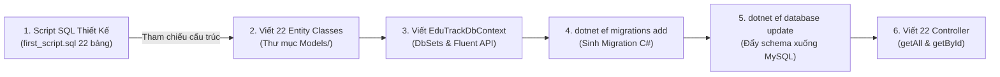

# EduTrack: Hướng Dẫn Quy Trình Code-First & Hiện Thực API GetAll, GetById (22 Bảng)

> **Dự án:** EduTrack - A Smart Learning Center Management System  
> **Khóa học:** CSW480 - Project Capstone 2  
> **Phương pháp tiếp cận:** **Code-First với EF Core Migrations** (Viết Entity Model trong C# trước $\rightarrow$ Sinh Migration $\rightarrow$ Đẩy Schema từ ASP.NET Core xuống CSDL MySQL)  
> **Căn cứ thiết kế:** Bản đặc tả cấu trúc `Capstone2/db/first_script.sql` (22 Bảng)  
> **Công nghệ:** ASP.NET Core Web API (.NET 8.0) + Entity Framework Core 8.0 + Pomelo MySQL Provider  

---

## 1. BẢN CHẤT QUY TRÌNH CODE-FIRST CỦA THẦY HƯỚNG DẪN

Thầy yêu cầu tiếp cận theo hướng **Code-First** vì các lý do sau trong dự án thực tế:
1. **Mã nguồn C# là Single Source of Truth:** Mọi cấu trúc bảng, ràng buộc khóa ngoại, kiểu dữ liệu, validation đều do Entity Classes và `DbContext` trong C# làm chủ.
2. **File `first_script.sql` đóng vai trò là Bản Thiết Kế (Schema Blueprint):** Ta không scaffold ngược từ DB lên nữa, mà dựa vào file script này để viết chính xác các class C# tương ứng.
3. **Đồng bộ hóa qua EF Migrations:** Dùng lệnh `dotnet ef migrations add InitialCreate` và `dotnet ef database update` để EF Core tự biên dịch code C# thành câu lệnh DDL và tạo/cập nhật bảng xuống MySQL. Khi có thay đổi sau này, chỉ cần sửa Entity C# và tạo Migration mới là DB tự động đồng bộ.



---

## 2. TO-DO LIST CHI TIẾT TỪNG BƯỚC THỰC HIỆN CODE-FIRST

---

### Bước 1: Cài đặt NuGet Packages EF Core
Mở Terminal tại thư mục `Capstone2/backend` (nơi chứa file `EduTrack.API.csproj`):

```bash
cd Capstone2/backend

# 1. Driver kết nối MySQL dành cho EF Core 8
dotnet add package Pomelo.EntityFrameworkCore.MySql --version 8.0.2

# 2. Công cụ Design phục vụ lệnh Migration
dotnet add package Microsoft.EntityFrameworkCore.Design --version 8.0.8

# 3. Công cụ CLI Tools cho EF Core
dotnet add package Microsoft.EntityFrameworkCore.Tools --version 8.0.8
```

---

### Bước 2: Khai báo Connection String (`appsettings.json`)
Mở file `Capstone2/backend/appsettings.json` và cấu hình chuỗi kết nối MySQL:

```json
{
  "ConnectionStrings": {
    "DefaultConnection": "Server=localhost;Port=3306;Database=edutrack_db;User=root;Password=your_mysql_password;CharSet=utf8mb4;"
  },
  "Logging": {
    "LogLevel": {
      "Default": "Information",
      "Microsoft.AspNetCore": "Warning"
    }
  },
  "AllowedHosts": "*"
}
```

---

### Bước 3: Viết 22 Entity Classes trong C# (`Capstone2/backend/Models/`)

Nhóm tạo các file C# tương ứng với 22 bảng trong thư mục `Models/`.  
**Quy ước chuyển đổi:**
- Tên thuộc tính trong C#: `PascalCase` (ví dụ `UserId`, `FullName`, `MustChangePassword`).
- Ánh xạ tên cột DB qua Data Annotation: `[Column("snake_case")]` (ví dụ `[Column("user_id")]`).
- Tên bảng: `[Table("table_name")]`.

Dưới đây là danh mục 22 file Entity cần tạo:

1. `User.cs` $\rightarrow$ Bảng `users` (có `MustChangePassword`, `PasswordChangedAt`).
2. `Role.cs` $\rightarrow$ Bảng `roles`.
3. `UserRole.cs` $\rightarrow$ Bảng `user_roles`.
4. `ParentStudent.cs` $\rightarrow$ Bảng `parent_students` (khóa chính phức hợp `ParentId`, `StudentId`).
5. `Subject.cs` $\rightarrow$ Bảng `subjects`.
6. `Class.cs` $\rightarrow$ Bảng `classes`.
7. `TeacherClass.cs` $\rightarrow$ Bảng `teacher_classes`.
8. `TaClass.cs` $\rightarrow$ Bảng `ta_classes`.
9. `StudentClass.cs` $\rightarrow$ Bảng `student_classes` (có `DroppedAt`, `DropReason`).
10. `ClassSchedule.cs` $\rightarrow$ Bảng `class_schedules`.
11. `ClassSession.cs` $\rightarrow$ Bảng `class_sessions`.
12. `ContentUnit.cs` $\rightarrow$ Bảng `content_units`.
13. `Attendance.cs` $\rightarrow$ Bảng `attendance`.
14. `Assignment.cs` $\rightarrow$ Bảng `assignments` (có `RubricJson`, `AnswerKeyText`, `IsAiGradingEnabled`).
15. `Submission.cs` $\rightarrow$ Bảng `submissions` (có `AiScore`, `AiFeedbackJson`).
16. `AiEvaluation.cs` $\rightarrow$ Bảng `ai_evaluations`.
17. `ProgressNote.cs` $\rightarrow$ Bảng `progress_notes`.
18. `TuitionInvoice.cs` $\rightarrow$ Bảng `tuition_invoices`.
19. `Payment.cs` $\rightarrow$ Bảng `payment`.
20. `ApprovalRequest.cs` $\rightarrow$ Bảng `approval_requests`.
21. `Notification.cs` $\rightarrow$ Bảng `notifications`.
22. `CenterSetting.cs` $\rightarrow$ Bảng `center_settings`.

#### Ví dụ Mẫu Entity 1: `User.cs`
```csharp
using System.ComponentModel.DataAnnotations;
using System.ComponentModel.DataAnnotations.Schema;

namespace EduTrack.API.Models
{
    [Table("users")]
    public class User
    {
        [Key]
        [Column("user_id")]
        public int UserId { get; set; }

        [Required]
        [StringLength(20)]
        [Column("user_code")]
        public string UserCode { get; set; } = null!;

        [Required]
        [StringLength(150)]
        [Column("full_name")]
        public string FullName { get; set; } = null!;

        [StringLength(150)]
        [Column("email")]
        public string? Email { get; set; }

        [StringLength(20)]
        [Column("phone")]
        public string? Phone { get; set; }

        [Required]
        [StringLength(255)]
        [Column("password_hash")]
        public string PasswordHash { get; set; } = null!;

        [StringLength(500)]
        [Column("avatar_url")]
        public string? AvatarUrl { get; set; }

        [Column("date_of_birth")]
        public DateTime? DateOfBirth { get; set; }

        [Column("gender")]
        public string? Gender { get; set; }

        [StringLength(100)]
        [Column("specialty")]
        public string? Specialty { get; set; }

        [Column("enrolled_since")]
        public DateTime? EnrolledSince { get; set; }

        [Required]
        [Column("status")]
        public string Status { get; set; } = "active";

        [Column("must_change_password")]
        public bool MustChangePassword { get; set; } = true;

        [Column("password_changed_at")]
        public DateTime? PasswordChangedAt { get; set; }

        [Column("created_at")]
        public DateTime CreatedAt { get; set; } = DateTime.UtcNow;

        // Navigation Properties
        public virtual ICollection<UserRole> UserRoles { get; set; } = new List<UserRole>();
        public virtual ICollection<ParentStudent> ParentLinks { get; set; } = new List<ParentStudent>();
        public virtual ICollection<ParentStudent> StudentLinks { get; set; } = new List<ParentStudent>();
    }
}
```

#### Ví dụ Mẫu Entity 2: `ParentStudent.cs` (Bảng mới duy nhất)
```csharp
using System.ComponentModel.DataAnnotations;
using System.ComponentModel.DataAnnotations.Schema;

namespace EduTrack.API.Models
{
    [Table("parent_students")]
    public class ParentStudent
    {
        [Column("parent_id")]
        public int ParentId { get; set; }

        [Column("student_id")]
        public int StudentId { get; set; }

        [Required]
        [StringLength(50)]
        [Column("relationship")]
        public string Relationship { get; set; } = "Parent";

        [Column("is_primary_contact")]
        public bool IsPrimaryContact { get; set; } = true;

        [Column("created_at")]
        public DateTime CreatedAt { get; set; } = DateTime.UtcNow;

        // Navigation Properties
        [ForeignKey("ParentId")]
        public virtual User Parent { get; set; } = null!;

        [ForeignKey("StudentId")]
        public virtual User Student { get; set; } = null!;
    }
}
```

#### Ví dụ Mẫu Entity 3: `Assignment.cs` (Có Rubric JSON & Answer Key)
```csharp
using System.ComponentModel.DataAnnotations;
using System.ComponentModel.DataAnnotations.Schema;

namespace EduTrack.API.Models
{
    [Table("assignments")]
    public class Assignment
    {
        [Key]
        [Column("assignment_id")]
        public int AssignmentId { get; set; }

        [Column("content_unit_id")]
        public int? ContentUnitId { get; set; }

        [Required]
        [Column("class_id")]
        public int ClassId { get; set; }

        [Required]
        [StringLength(200)]
        [Column("title")]
        public string Title { get; set; } = null!;

        [Column("description")]
        public string? Description { get; set; }

        [StringLength(500)]
        [Column("file_url")]
        public string? FileUrl { get; set; }

        [Required]
        [Column("due_date")]
        public DateTime DueDate { get; set; }

        [Column("max_score", TypeName = "decimal(5,2)")]
        public decimal MaxScore { get; set; } = 10.00m;

        [Required]
        [Column("created_by")]
        public int CreatedBy { get; set; }

        [Column("answer_key_text")]
        public string? AnswerKeyText { get; set; }

        [StringLength(500)]
        [Column("answer_key_file_url")]
        public string? AnswerKeyFileUrl { get; set; }

        [Column("rubric_json", TypeName = "json")]
        public string? RubricJson { get; set; }

        [Column("is_ai_grading_enabled")]
        public bool IsAiGradingEnabled { get; set; } = true;

        // Navigation Properties
        [ForeignKey("ClassId")]
        public virtual Class Class { get; set; } = null!;

        [ForeignKey("CreatedBy")]
        public virtual User Creator { get; set; } = null!;

        public virtual ICollection<Submission> Submissions { get; set; } = new List<Submission>();
    }
}
```

---

### Bước 4: Viết `EduTrackDbContext.cs` với Fluent API
Tạo file `Capstone2/backend/Models/EduTrackDbContext.cs` để cấu hình 22 `DbSet` và các ràng buộc đặc biệt:

```csharp
using Microsoft.EntityFrameworkCore;

namespace EduTrack.API.Models
{
    public class EduTrackDbContext : DbContext
    {
        public EduTrackDbContext(DbContextOptions<EduTrackDbContext> options) : base(options) { }

        // Khai báo 22 DbSet
        public virtual DbSet<User> Users { get; set; } = null!;
        public virtual DbSet<Role> Roles { get; set; } = null!;
        public virtual DbSet<UserRole> UserRoles { get; set; } = null!;
        public virtual DbSet<ParentStudent> ParentStudents { get; set; } = null!;
        public virtual DbSet<Subject> Subjects { get; set; } = null!;
        public virtual DbSet<Class> Classes { get; set; } = null!;
        public virtual DbSet<TeacherClass> TeacherClasses { get; set; } = null!;
        public virtual DbSet<TaClass> TaClasses { get; set; } = null!;
        public virtual DbSet<StudentClass> StudentClasses { get; set; } = null!;
        public virtual DbSet<ClassSchedule> ClassSchedules { get; set; } = null!;
        public virtual DbSet<ClassSession> ClassSessions { get; set; } = null!;
        public virtual DbSet<ContentUnit> ContentUnits { get; set; } = null!;
        public virtual DbSet<Attendance> Attendances { get; set; } = null!;
        public virtual DbSet<Assignment> Assignments { get; set; } = null!;
        public virtual DbSet<Submission> Submissions { get; set; } = null!;
        public virtual DbSet<AiEvaluation> AiEvaluations { get; set; } = null!;
        public virtual DbSet<ProgressNote> ProgressNotes { get; set; } = null!;
        public virtual DbSet<TuitionInvoice> TuitionInvoices { get; set; } = null!;
        public virtual DbSet<Payment> Payments { get; set; } = null!;
        public virtual DbSet<ApprovalRequest> ApprovalRequests { get; set; } = null!;
        public virtual DbSet<Notification> Notifications { get; set; } = null!;
        public virtual DbSet<CenterSetting> CenterSettings { get; set; } = null!;

        protected override void OnModelCreating(ModelBuilder modelBuilder)
        {
            base.OnModelCreating(modelBuilder);

            // 1. Cấu hình Composite Key cho parent_students
            modelBuilder.Entity<ParentStudent>()
                .HasKey(ps => new { ps.ParentId, ps.StudentId });

            modelBuilder.Entity<ParentStudent>()
                .HasOne(ps => ps.Parent)
                .WithMany(u => u.ParentLinks)
                .HasForeignKey(ps => ps.ParentId)
                .OnDelete(DeleteBehavior.Cascade);

            modelBuilder.Entity<ParentStudent>()
                .HasOne(ps => ps.Student)
                .WithMany(u => u.StudentLinks)
                .HasForeignKey(ps => ps.StudentId)
                .OnDelete(DeleteBehavior.Cascade);

            // 2. Cấu hình Composite Key cho user_roles
            modelBuilder.Entity<UserRole>()
                .HasKey(ur => new { ur.UserId, ur.RoleId });

            // 3. Unique Index cho các trường mã code và email
            modelBuilder.Entity<User>()
                .HasIndex(u => u.UserCode)
                .IsUnique();

            modelBuilder.Entity<User>()
                .HasIndex(u => u.Email)
                .IsUnique();

            modelBuilder.Entity<ApprovalRequest>()
                .HasIndex(ar => ar.RequestCode)
                .IsUnique();

            modelBuilder.Entity<CenterSetting>()
                .HasIndex(cs => cs.SettingKey)
                .IsUnique();
        }
    }
}
```

---

### Bước 5: Đăng ký DbContext trong `Program.cs`
Cập nhật file `Capstone2/backend/Program.cs`:

```csharp
using Microsoft.EntityFrameworkCore;
using EduTrack.API.Models;

var builder = WebApplication.CreateBuilder(args);

// Cấu hình Pomelo MySQL Provider
var connectionString = builder.Configuration.GetConnectionString("DefaultConnection");
builder.Services.AddDbContext<EduTrackDbContext>(options =>
    options.UseMySql(connectionString, ServerVersion.AutoDetect(connectionString))
);

builder.Services.AddControllers()
    .AddJsonOptions(options =>
    {
        // Tránh vòng lặp tuần hoàn khi lấy quan hệ cha con
        options.JsonSerializerOptions.ReferenceHandler = System.Text.Json.Serialization.ReferenceHandler.IgnoreCycles;
    });

builder.Services.AddEndpointsApiExplorer();
builder.Services.AddSwaggerGen();

var app = builder.Build();

if (app.Environment.IsDevelopment())
{
    app.UseSwagger();
    app.UseSwaggerUI();
}

app.UseHttpsRedirection();
app.UseAuthorization();
app.MapControllers();

app.Run();
```

---

### Bước 6: Chạy Migration để đẩy Schema xuống MySQL (Scaffold từ ASP xuống DB)

Mở Terminal và thực thi 2 lệnh EF Core Migration:

```bash
# 1. Sinh file Migration từ code C#
dotnet ef migrations add InitialCreate

# 2. Thực thi Migration đẩy trực tiếp cấu trúc bảng xuống MySQL
dotnet ef database update
```

Sau khi chạy xong lệnh `database update`:
- Mở MySQL Workbench hoặc DBeaver kiểm tra cơ sở dữ liệu `edutrack_db`.
- Bạn sẽ thấy toàn bộ 22 bảng được tự động tạo với đầy đủ khóa chính, khóa ngoại, kiểu dữ liệu khớp 100% với code C#.
- File migration được lưu trong thư mục `Capstone2/backend/Migrations/` để quản lý lịch sử phiên bản schema của nhóm.

---

## 3. DANH SÁCH 22 CONTROLLER & HIỆN THỰC API GETALL, GETBYID

Sau khi Entity Models và DB đã đồng bộ qua Migration, nhóm tiến hành tạo 22 Controller trong thư mục `Controllers/` để hoàn thành task của Thầy:

| STT | Bảng CSDL | Tên Controller | Endpoint GetAll | Endpoint GetById | Tham số Khóa chính |
| :---: | :--- | :--- | :--- | :--- | :--- |
| **1** | `users` | `UsersController.cs` | `GET /api/users` | `GET /api/users/{id}` | `int id` |
| **2** | `roles` | `RolesController.cs` | `GET /api/roles` | `GET /api/roles/{id}` | `int id` |
| **3** | `user_roles` | `UserRolesController.cs` | `GET /api/user-roles` | `GET /api/user-roles/{userId}/{roleId}` | Khóa kép |
| **4** | `parent_students` | `ParentStudentsController.cs` | `GET /api/parent-students` | `GET /api/parent-students/{parentId}/{studentId}` | Khóa kép |
| **5** | `subjects` | `SubjectsController.cs` | `GET /api/subjects` | `GET /api/subjects/{id}` | `int id` |
| **6** | `classes` | `ClassesController.cs` | `GET /api/classes` | `GET /api/classes/{id}` | `int id` |
| **7** | `teacher_classes` | `TeacherClassesController.cs` | `GET /api/teacher-classes` | `GET /api/teacher-classes/{id}` | `int id` |
| **8** | `ta_classes` | `TaClassesController.cs` | `GET /api/ta-classes` | `GET /api/ta-classes/{id}` | `int id` |
| **9** | `student_classes` | `StudentClassesController.cs` | `GET /api/student-classes` | `GET /api/student-classes/{id}` | `int id` |
| **10** | `class_schedules` | `ClassSchedulesController.cs` | `GET /api/class-schedules` | `GET /api/class-schedules/{id}` | `int id` |
| **11** | `class_sessions` | `ClassSessionsController.cs` | `GET /api/class-sessions` | `GET /api/class-sessions/{id}` | `int id` |
| **12** | `content_units` | `ContentUnitsController.cs` | `GET /api/content-units` | `GET /api/content-units/{id}` | `int id` |
| **13** | `attendance` | `AttendanceController.cs` | `GET /api/attendance` | `GET /api/attendance/{id}` | `int id` |
| **14** | `assignments` | `AssignmentsController.cs` | `GET /api/assignments` | `GET /api/assignments/{id}` | `int id` |
| **15** | `submissions` | `SubmissionsController.cs` | `GET /api/submissions` | `GET /api/submissions/{id}` | `int id` |
| **16** | `ai_evaluations` | `AiEvaluationsController.cs` | `GET /api/ai-evaluations` | `GET /api/ai-evaluations/{id}` | `int id` |
| **17** | `progress_notes` | `ProgressNotesController.cs` | `GET /api/progress-notes` | `GET /api/progress-notes/{id}` | `int id` |
| **18** | `tuition_invoices`| `TuitionInvoicesController.cs`| `GET /api/tuition-invoices` | `GET /api/tuition-invoices/{id}` | `int id` |
| **19** | `payment` | `PaymentsController.cs` | `GET /api/payments` | `GET /api/payments/{id}` | `int id` |
| **20** | `approval_requests`| `ApprovalRequestsController.cs`| `GET /api/approval-requests`| `GET /api/approval-requests/{id}`| `int id` |
| **21** | `notifications` | `NotificationsController.cs` | `GET /api/notifications` | `GET /api/notifications/{id}` | `int id` |
| **22** | `center_settings` | `CenterSettingsController.cs` | `GET /api/center-settings` | `GET /api/center-settings/{id}` | `int id` |

---

## 4. MÃ NGUỒN CONTROLLER MẪU CHUẨN

### Mẫu 1: Controller Đơn Khóa (`ClassesController.cs`)
```csharp
using Microsoft.AspNetCore.Mvc;
using Microsoft.EntityFrameworkCore;
using EduTrack.API.Models;

namespace EduTrack.API.Controllers
{
    [ApiController]
    [Route("api/[controller]")]
    public class ClassesController : ControllerBase
    {
        private readonly EduTrackDbContext _context;

        public ClassesController(EduTrackDbContext context)
        {
            _context = context;
        }

        // 1. GET ALL
        [HttpGet]
        public async Task<IActionResult> GetAll()
        {
            try
            {
                var items = await _context.Classes
                    .Include(c => c.Subject)
                    .AsNoTracking()
                    .ToListAsync();

                return Ok(new
                {
                    success = true,
                    message = "Retrieved all classes successfully",
                    data = items,
                    errors = (object?)null
                });
            }
            catch (Exception ex)
            {
                return StatusCode(500, new
                {
                    success = false,
                    message = "Internal server error occurred",
                    data = (object?)null,
                    errors = ex.Message
                });
            }
        }

        // 2. GET BY ID
        [HttpGet("{id}")]
        public async Task<IActionResult> GetById(int id)
        {
            try
            {
                var item = await _context.Classes
                    .Include(c => c.Subject)
                    .AsNoTracking()
                    .FirstOrDefaultAsync(c => c.ClassId == id);

                if (item == null)
                {
                    return NotFound(new
                    {
                        success = false,
                        message = $"Class with ID {id} was not found",
                        data = (object?)null,
                        errors = "Not Found"
                    });
                }

                return Ok(new
                {
                    success = true,
                    message = $"Retrieved class {id} successfully",
                    data = item,
                    errors = (object?)null
                });
            }
            catch (Exception ex)
            {
                return StatusCode(500, new
                {
                    success = false,
                    message = "Internal server error occurred",
                    data = (object?)null,
                    errors = ex.Message
                });
            }
        }
    }
}
```

---

### Mẫu 2: Controller Khóa Kép (`ParentStudentsController.cs`)
```csharp
using Microsoft.AspNetCore.Mvc;
using Microsoft.EntityFrameworkCore;
using EduTrack.API.Models;

namespace EduTrack.API.Controllers
{
    [ApiController]
    [Route("api/[controller]")]
    public class ParentStudentsController : ControllerBase
    {
        private readonly EduTrackDbContext _context;

        public ParentStudentsController(EduTrackDbContext context)
        {
            _context = context;
        }

        // 1. GET ALL
        [HttpGet]
        public async Task<IActionResult> GetAll()
        {
            try
            {
                var items = await _context.ParentStudents
                    .Include(ps => ps.Parent)
                    .Include(ps => ps.Student)
                    .AsNoTracking()
                    .ToListAsync();

                return Ok(new
                {
                    success = true,
                    message = "Retrieved all parent-student relationships successfully",
                    data = items,
                    errors = (object?)null
                });
            }
            catch (Exception ex)
            {
                return StatusCode(500, new
                {
                    success = false,
                    message = "Internal server error occurred",
                    data = (object?)null,
                    errors = ex.Message
                });
            }
        }

        // 2. GET BY COMPOSITE KEY
        [HttpGet("{parentId}/{studentId}")]
        public async Task<IActionResult> GetById(int parentId, int studentId)
        {
            try
            {
                var item = await _context.ParentStudents
                    .Include(ps => ps.Parent)
                    .Include(ps => ps.Student)
                    .AsNoTracking()
                    .FirstOrDefaultAsync(ps => ps.ParentId == parentId && ps.StudentId == studentId);

                if (item == null)
                {
                    return NotFound(new
                    {
                        success = false,
                        message = $"Relationship for Parent {parentId} and Student {studentId} was not found",
                        data = (object?)null,
                        errors = "Not Found"
                    });
                }

                return Ok(new
                {
                    success = true,
                    message = "Retrieved parent-student relationship successfully",
                    data = item,
                    errors = (object?)null
                });
            }
            catch (Exception ex)
            {
                return StatusCode(500, new
                {
                    success = false,
                    message = "Internal server error occurred",
                    data = (object?)null,
                    errors = ex.Message
                });
            }
        }
    }
}
```

---

